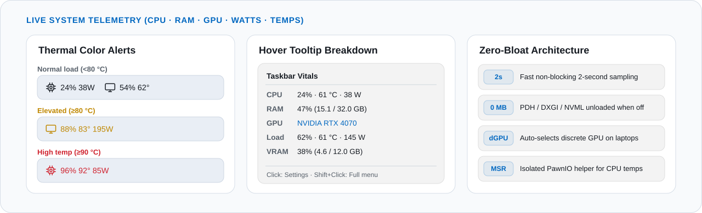
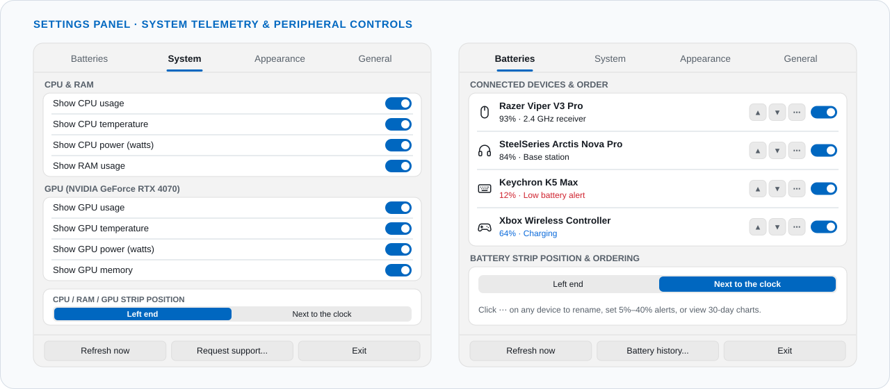

<div align="center">


<h1>Taskbar Vitals</h1>

<p>
  <strong>Live CPU, RAM, GPU &amp; wattage telemetry alongside wireless peripheral battery levels — natively on your Windows taskbar.</strong>
</p>

<p>
  <a href="https://github.com/symNistaken/TaskbarVitals/releases/latest"></a>
  <a href="https://github.com/symNistaken/TaskbarVitals/actions/workflows/build.yml"></a>
  <a href="https://github.com/symNistaken/TaskbarVitals/releases"></a>
  <a href="LICENSE"></a>
  <a href="https://github.com/symNistaken/TaskbarVitals/issues/new/choose"></a>
</p>

<p>
  <a href="#installation">Install</a> ·
  <a href="#why-taskbar-vitals">Features</a> ·
  <a href="#live-system-telemetry-cpu--ram--gpu--watts--temps">System Vitals</a> ·
  <a href="#supported-hardware">Supported Hardware</a> ·
  <a href="#cli--automation">CLI</a> ·
  <a href="#support-the-project">Support</a> ·
  <a href="SECURITY.md">Security</a>
</p>

<picture>
  <source media="(prefers-color-scheme: dark)" srcset="docs/readme/banner-dark.svg">
  
</picture>

<p><em>Illustrative taskbar preview — sample CPU, GPU, RAM and wireless peripheral readings.</em></p>

</div>

---

> **Quick Start:** Download **[TaskbarVitals-Setup](https://github.com/symNistaken/TaskbarVitals/releases/latest)** and pick **Install for me only** (no administrator rights required), or grab the portable ZIP from the same release page.
>
> **Migrating from WirelessBattery / BatteryHub:** Installing Taskbar Vitals over an existing copy automatically preserves your saved device aliases, alert thresholds, startup preference, and 30-day battery history. Taskbar Vitals is an independent GPL-3.0-or-later project built from the public BatteryHub codebase and expanded with live system monitoring, a redesigned settings panel, custom strip layouts, and signed updates.

---

## Why Taskbar Vitals?

Most peripheral apps eat hundreds of megabytes of RAM just to tell you your mouse is at 40%, while separate overlays clutter your screen to show CPU/GPU metrics. **Taskbar Vitals** replaces both with a single tiny native C++17 / Win32 binary.

| Pillar | What You Get |
|---|---|
| **Live System Vitals Strip** | Real-time **CPU** usage (%) and package power (W), **RAM** usage (% and GB), and **GPU** load (%), temperature (°C), VRAM usage (% and GB), and board wattage (W via NVML), with custom **System item order**. |
| **Direct Peripheral Engine** | Read-only battery & charging status for wireless mice, keyboards, headsets, earbuds, gamepads, and linked Android phones across **75+ brand/protocol families** without manufacturer bloatware. |
| **Dual-Strip Taskbar Layout** | Keep **System Vitals** pinned to the **Left end of the taskbar** while keeping **Peripheral Batteries** **Next to the clock** — or combine both into one strip, target specific monitors, or switch to per-device tray icons. |
| **15 Brand Color Themes & Aliases** | Automatic color-coded level bars for Razer, Logitech, SteelSeries, Corsair, ROG, ZOWIE, HyperX, PlayStation, Xbox, Samsung, Apple, Jabra, JBL, Cooler Master, and Steam, plus custom device names (up to 64 chars). |
| **Smart Alerts & 30-Day Charts** | Per-device low-battery alerts (5%–40% thresholds with smart re-arm) and a DPI-aware native **24h / 7d / 30d** discharge chart with conservative time-to-empty estimation. |
| **100% Local & Signed Updates** | Zero accounts, zero cloud telemetry. Official Windows updates verify ECDSA P-256 `SHA256SUMS.txt.sig` signatures offline before executing an installer. |

---

## Live System Telemetry (CPU · RAM · GPU · Watts · Temps)

Enable hardware vitals without running heavyweight overlays or kernel-heavy suites. **Taskbar Vitals** samples metrics every 2 seconds on demand and keeps your taskbar clean:

<p align="center">
  <picture>
    <source media="(prefers-color-scheme: dark)" srcset="docs/readme/vitals-dark.svg">
    
  </picture>
</p>

| Component | What Is Measured | How It Works Under the Hood |
|---|---|---|
| **Processor (CPU)** | Overall core load (`%`), package wattage (`W`), and optional package temperature (`°C`) | Load via `GetSystemTimes`; RAPL wattage via Windows **Energy Meter** PDH counters; optional CPU package temp via the isolated `TaskbarVitalsTemp.exe` helper (`PawnIO` `IntelMSR`, read-only). |
| **Memory (RAM)** | Physical memory percentage + `Used / Total GB` in hover tooltip | Native `GlobalMemoryStatusEx` call with virtually zero CPU cost. |
| **Graphics (GPU & VRAM)** | Engine usage (`%`), temperature (`°C`), board wattage (`W`), and VRAM (`%` & `GB`) | Automatically targets the adapter with the largest dedicated VRAM (discrete GPU on dual-GPU laptops) via DXGI, PDH (`GPU Engine` / `GPU Adapter Memory`), WDDM `D3DKMTQueryAdapterInfo`, and `nvml.dll`. |
| **Thermal Warnings & Cleanup** | Automatic color shifts at **≥80 °C (orange)** and **≥90 °C (red)** | Performance counters and optional DLLs (`pdh.dll`, `dxgi.dll`, `nvml.dll`) are delay-loaded on first use and freed immediately if you turn system readings off. |

---

## Redesigned Settings Panel & Dual-Strip Layout

Click anywhere on the taskbar strip to open the modern, DPI-aware **Settings Panel** (or **Shift + Click** to open the classic fast context menu). Both taskbar strips follow Windows 10/11 dark and light themes automatically.

<p align="center">
  <picture>
    <source media="(prefers-color-scheme: dark)" srcset="docs/readme/panel-dark.svg">
    
  </picture>
</p>

<p align="center">
  <picture>
    <source media="(prefers-color-scheme: dark)" srcset="docs/readme/states-dark.svg">
    
  </picture>
</p>

<details>
  <summary><strong>View live Windows taskbar screenshot</strong></summary>
  <p align="center"></p>
</details>

### Strip Indicators & Settings Tabs

| Tab / Area | Controls & Behavior |
|---|---|
| **Batteries** | Reorder or hide peripherals, set custom names (up to 64 chars), pick **Battery strip position** (**Left end** vs **Next to the clock**), open **Battery history** charts, and set per-device alerts (5%–40%). |
| **System** | Independently toggle CPU %, CPU °C, CPU watts, RAM %, GPU %, GPU °C, GPU watts, and VRAM, adjust **System item order**, and choose **CPU / RAM / GPU strip position**. *(Strips merge smoothly if the left end gets crowded.)* |
| **Appearance** | Switch between Taskbar strip and Tray icons, target All / Main / Selected monitor, stack icons above percentages, toggle 15 brand color bars, or add a backdrop plate for transparent taskbars. |
| **General** | Set battery refresh interval (default 60s), pick from 20 built-in languages, manage local history and signed update checks, or launch **Request support for a device**. |
| **Indicator States** | Red `%` marks ≤15%; blue `⚡` indicates active charging; green `✓` marks 100% on power; dimmed items retain the last reading while asleep; `×` marks explicit offline links; small badges distinguish identical devices. |

---

## Supported Hardware

Taskbar Vitals communicates strictly in **read-only mode** via HID, USB, Bluetooth, or RFCOMM. A brand name alone does not guarantee every model works — verify your model, connection mode, or receiver `VID:PID` (`TaskbarVitals.exe --dump`) below.

| Category | Representative Supported Brands & Ecosystems |
|---|---|
| **Gaming Mice** | Logitech, Razer, SteelSeries, Corsair, Pulsar, LAMZU, Endgame Gear, VAXEE, Finalmouse, WLMouse, ZOWIE, Glorious, Hitscan, Ninjutso, Arbiter Studio, ATK / VXE, MCHOSE, Kysona, DAREU, Rapoo VT, RAWM, Incott, Scyrox, Sprime, Darmoshark, EWEADN, Machenike, Redragon, MSI, Cooler Master, Fantech, Sharkoon, Zenith, Motospeed, Delux, Ajazz, HECATE, Taidu, Wraith, Niceboy |
| **Wireless Keyboards** | Logitech, Razer, ASUS ROG, Keychron (Bluetooth & patched 2.4 GHz), NuPhy, CHERRY MX 3.0S, AULA, MCHOSE, ATK / VGN / VXE, PMO / WOBKEY / URX / EVO80 (`36B0`), SONiX (`AK820 MAX`, `AK820 Pro`, `EA75`, `F108 Pro`, `P75`, etc.), Semico (`X98`, `AK820 Max Plus`), Redragon (`Horus Pro`, `K742B`), DAREU (`A84`, `EK75 Pro`), Royal Kludge, DARKRIM |
| **Headsets & Earbuds** | Apple AirPods / Beats, Samsung Galaxy Buds, Nothing / CMF Buds, ASTRO (`A50 X / Gen 5 / Gen 4 / Gen 3 / A20`), Sony INZONE (`H9 II`, `H5`, `Buds`), SteelSeries Arctis & GameBuds, HyperX Cloud & Stinger, Razer BlackShark & Barracuda, Logitech G & G435, Corsair Void / Virtuoso / HS, JBL Quantum, Audeze Maxwell / 2, Turtle Beach Stealth 700 Gen 3, Alienware AW920H, Jabra GNP, AKG N9 Hybrid, Fractal Scape, Poly BT600, ATK N9 / Mercury, MCHOSE V9, AULA A7Pro, VGN OMNISOUND, MOONDROP GM01 Pro, ENDORFY Viro, Google Fast Pair, HeadsetControl 4.3.0 |
| **Controllers & Phones** | Xbox Wireless / Bluetooth, PlayStation DualShock 4 / DualSense / Edge, Switch Pro (`057E:2009`), 8BitDo (`Ultimate 2` / `2C` / `Pro 2/3`), GameSir (`Nova`, `G7 Pro`, `Cyclone 2`, `Cyclone Pro`, `Super Nova`, `Tarantula Pro`), Flydigi (`Vader 5 Pro`, `Apex 5`), BEITONG (`KP20`, `KP40D`), Android phones via Microsoft Phone Link, Generic HID Battery |

<details>
  <summary><strong>Full A–Z Hardware &amp; Protocol Compatibility Matrix (all 79 vendor &amp; fallback entries)</strong></summary>

| Vendor / Family | Supported Models &amp; VID:PIDs | Protocol &amp; Notes |
|---|---|---|
| **8BitDo** | Ultimate 2 Wireless (X-input `2DC8:310B` tested on 2.4 GHz dongle; D-input `2DC8:6012` hold B, firmware 1.03+, dongle / USB / BT), Ultimate 2C Wireless, Ultimate 3-mode / 2.4G / Bluetooth, Pro 3 / Pro 2, SN30 Pro, SF30 Pro | Vendor HID status query (`FF7A` / `FFA0`) and SDL gamepad input report `01` / `04`, with charging state |
| **AKG** | N9 Hybrid on USB dongle (`0ECB:20D9`, tested) | Airoha RACE on `FF13:0001`: output `06`, input `07`, battery attribute `0CD6` (read-only) |
| **Akko** | Akko Air 01 (`3151:5006`, tested), V9 Dash Pro (`38EE:000C`, tested), Dash V9 Ultra (`38EE:000F`, tested) on 2.4 GHz receiver | Air 01: Rongyuan `0xF7` status report; V9 Dash Pro / Ultra: read-only 64-byte `0x1A` query on `FF1C:0092` (charging supported on Pro) |
| **Alienware** | AW920H headset on 2.4 GHz dongle (`413C:A515`, tested); Bluetooth handled via Bluetooth fallback | Vendor query `06 C0 0A` on `FF13:0001`, XOR-checksummed reply `07` (level, charging, critical) |
| **Apple AirPods / Beats** | AirPods Max (tested, `200A` Lightning &amp; `201F` USB-C), AirPods Pro 3 (tested, `2027`), AirPods Pro 1/2, AirPods 1–5, Beats headphones/earbuds | BLE proximity pairing (`0x07`) broadcasts matched to paired device (10% steps + charging; L/R/case for earbuds) |
| **Arbiter Studio** | Akitsu (`373E:000A` 8K / `0009` cable), Akitsu 3950 (`373E:0039` 8K / `0038` cable), Akitsu Medium (`373E:0067` 8K &amp; `0066` cable, both tested) | Read-only vendor feature report `0x83` on `FFFF:0000` (battery &amp; charging) |
| **ASTRO** | A50 X (`046D:0B0B`, tested), A50 Gen 5 (`046D:0B1C`), A50 Gen 4 (`9886:002C` tested, `002D`/`002A`), A50 Gen 3 (`9886:0015` tested, `0014`/`0018`/`001D`/`0026`), A20 Wireless (`9886:0037`–`0045`) via USB base station | Vendor status protocol: battery percentage, charging, and docked state |
| **ASUS ROG** | Strix Scope II 96 (RX), Azoth, Falchion keyboards; Keris, Harpe, Gladius, Chakram, Spatha, Pugio, Strix Impact mice; Pelta headset (2.4 GHz dongle); Cetra Open Wireless earbuds (SpeedNova `0B05:1CAC`, L/R/case); Omni Receiver | ROG HID battery query |
| **ATK / VXE / VGN** | **Mice:** VXE R1 / R1 Pro Max / R1 SE+ / X3 Pro, ATK F1 Extreme (Kysona-shared; R1 cables pair with receivers `3554:F58F`/`373B:1085` &amp; `373B:1272`/`3554:F58A`); VXE R1 NK &amp; NearLink mice (`373B:1216`); ATK Zero (`373B:1154` cable, `124F`/`1155` 8K L0/L1); ATK 8K Nano (`373B:1178`).<br>**Keyboards:** ATK V75X, VGN/VXE S99, V98 Pro/V2, N75 Pro, VXE75/V2, VXE V87, Feker Alice80 (tested) on `320F:5088`/`5055`; ATK Z87 (`373B:1012`, tested).<br>**Headsets:** ATK N9 Pro, N9 Ultra (tested); ATK Mercury I / M1 (`373B:107C` v0005); VGN OMNISOUND / ZHOUTING (`372E:10BB`, tested) | Mice: Kysona checksummed, BITMOUSE report `08` on `FF05:0001`, or Holtek `82` on `FF10:0001`.<br>Keyboards: Evision report `04` cmd `1A` (polled ≤10m); Z87 on `FF1C:0092`.<br>Headsets: N9 virtual COM (close ATK app); Mercury `FF22:0001` (no charging); OMNISOUND V HUB `55 65 01` on `000C:0001` |
| **Attack Shark &amp; Shared Receivers** | Rongyuan receivers (81 models incl. Attack Shark R3, AJAZZ AJ179 Pro `3151:402D`, K86, X82 PRO HE, Ajazz/MSI boards; K86 BT shown as keyboard); Xenta receivers (Attack Shark X6/R1, X11, X3 Max, V3 Pro, V6; X6 also `1D57:FA61` untested); Semico `1A2C` boards (Attack Shark X98 `1A2C:8FFF` tested &amp; `A034` cable; AJAZZ AK820 Max Plus `1A2C:8FFF`/`A036`) | Rongyuan status report; Xenta passive broadcasts; Semico read-only `0x0E` (`AA 55 CC 33` on `FF02:0002`, charging flag omitted on X98) |
| **Audeze** | Maxwell (`3329:4B19` dongle, `3329:4B1A` USB-C cable), Maxwell 2 (`3329:4B29` dongle, tested); Xbox IDs untested | Airoha RACE report `06` / `07`, battery attribute `0CD6` (single read-only query) |
| **AULA** | F75 / F87 Pro / F99 keyboards (2.4 GHz); X9 Ultra (tested) &amp; V9 mice (`320F:22A0` AULA-8K); SC580 / SC580X mouse (`088D:062E` cable, `089D:062F` receiver, both tested); HERO 68 Air (`372E:106C`, tested); A7Pro headset (`38A6:0001`, tested); *(F108 Pro under SONiX)* | F-series: `0x13`/`0x4A` checksummed (BT/wired untested); X9: `FF1C:0092` cmd `1A` (2.4 GHz); SC580: `0x30` on `FF02:0000` (2.4 GHz/USB); HERO 68: 20-byte `0x87` on `FF60`; A7Pro: `55 65 01` on `FF90:0001` (2.4 GHz) |
| **BEITONG** | KP20 / BTP-KP20 (`20BC:5128`, XInput, tested) &amp; KP40D / BTP-KP40D (`20BC:515C`, XInput) on 2.4 GHz receiver | Read-only nibble-scrambled report `02` on usage page `00FF` with charging state (no iControl needed) |
| **CHERRY / XTRFY** | MX 3.0S Wireless keyboard (`046A:00EA` dongle, `046A:00E3` cable, both tested); Cherry XTRFY mouse on 1K receiver (`046A:0330`, tested) | MX 3.0S: `1A` on `FF1C:0092` + USB power state (BT via Bluetooth); XTRFY: CompX 17-byte `08 03`/`08 04` |
| **Cooler Master** | MM712 (tested), MM731 over 2.4 GHz dongle or USB cable | Read-only vendor HID status report |
| **Corsair** | Void / Void Pro / Void Elite / HS70 / HS80; Bragi devices (Virtuoso, Void V2, HS80 MAX, Slipstream mice/keyboards incl. `1B1C:2B00` Scimitar Elite SE Wireless &amp; Dark Core RGB Pro SE `1B1C:1BDC`); Sabre V2 Pro Ultralight (`1B1C:2B2A`, tested); Sabre v2 PRO WIRELESS MG (`1B1C:2B34`, untested) | Vendor HID reports, Bragi `GET`, and Compx 17-byte battery protocol (all read-only) |
| **DAREU** | EM901X (`260D:1074` receiver / `1090` cable, tested); A84 keyboard (`260D:0022`, untested); A980 Pro (`260D:1131` receiver / `1148` cable, tested); A950 Wing (`260D:1154` receiver / `1196` cable, tested); EK75 Pro (`260D:0042` receiver / `0046` cable, tested) | EM901X: report `08`/`09`; A84: SONiX `04 F6`; A980 Pro &amp; EK75 Pro: Togran 65-byte report `0A`; A950 Wing: Compx 17-byte on `FF02:0002` (mV + charging) |
| **DARKRIM** | SHADOW (寸渊影弑) on `3654:6901` USB receiver (tested) | Read-only CRC-checked battery query &amp; charging flag in 10% steps ([protocol notes](docs/darkrim.md)) |
| **Darmoshark** | M3 (`248A:FF30`) &amp; M3S (`248A:FF31`) on 2.4 GHz receiver; M3S Pro on Nordic 1K receiver (`1915:0723`) | M3/M3S: HID feature report; M3S Pro: vendor query on `FF0A` |
| **ENDORFY** | Viro Wireless on 2.4 GHz dongle (`3738:0072`, untested) | Read-only Airoha RACE `0CD6` on report `06`/`07` (no charging state) |
| **Endgame Gear** | OP1w 4k (v1/v2), XM2w 4k (v1/v2) on 4K dongle; XM2we (`3367:1961`) | Read-only vendor feature report `A1` cmd `B4` |
| **EWEADN (前行者)** | S7 Max / Pro / Ultra &amp; S9 Max / Pro / Ultra / Ultra+ (`372E:103D` receiver); S9 Ultra (`372E:1027` cable) | Read-only feature report `03` (`47`, `4F 81`) on `FF00:0001` with charging bit |
| **Fantech** | Helios Go XD5 (`25A7:FA7B` cable, `25A7:FA7C` dongle tested); Raigor III (`1EA7:0066` tested) &amp; Raigor II WG10 (`1EA7:0066`/`0064`, untested) | XD5: `08 04` with `0x55` checksum; Raigor: `B5` status-page query on `FFB5:0001` (no charging state) |
| **Finalmouse** | UltralightX (`361D:0100`, tested); Starlight X (`361D:0300`/`0301`, tested); dongles only | xpanel `FF00` read-only GETs + wake (`0xE0`), voltage curve / % + charging |
| **Flydigi** | Vader 5 Pro / 黑武士 5 Pro (`37D7:2401`) &amp; Apex 5 (`37D7:2501`, tested) over 2.4 GHz or USB | `FFA0:0001` vendor info query (20% steps + charging; no Space Station needed) |
| **Fractal Design** | Scape headset on 2.4 GHz dongle or USB-C cable | `GET_DEVICE_STATE` query on usage page `FF00` |
| **G-Wolves** | Fenrir / Pro / Max / Asym, HTX, HTS, HSK, HTR, HT-S2, Lycan, WARG, VUK &amp; 8K dongles | Glorious or Kysona protocol depending on model |
| **GameSir** | Nova Lite / Nova 2 / Nova 2 Lite (2.4 GHz / USB), G7 Pro (tested, ZZZ `3537:105E`) &amp; Xbox GIP mode pads, Cyclone 2 (XInput), Cyclone Pro (`3537:1015` dongle + initial BLE pair), Super Nova / NovaPro (`3537:103E` tested / `100E` cable), Tarantula Pro (`3537:103E`/`1050`) | `FF7A`, `FFF0`, `Windows.Gaming.Input`, BLE service `0x8650` ([Cyclone Pro notes](docs/gamesir_cyclone_pro.md)), and SAPJoy `FFA0` ([SAPJoy notes](docs/gamesir_sapjoy.md)) |
| **Glorious** | Model O / O- / D / D- Wireless (tested), Model O 2 / D 2 PRO | Vendor feature report |
| **HECATE** | G5M PRO (tested, `35BB:D3FB`) &amp; sibling mice on same receiver / USB cables `35BB:D3FA`/`D3FC`/`D3FD` | Kysona protocol *(G2 Wireless 7.1 dongle `35BB:A009`/`A209` unsupported)* |
| **Hitscan** | Hyperlight X, Hyperlight N, Hyperlight | Glorious feature report or shared Kysona checksummed protocol |
| **HyperX** | Cloud III / III S, Cloud II (HP/Kingston/DTS) / II Core, Cloud Alpha / Alpha 2, Cloud Flight (`03F0:0C8C` PS untested) / Flight S, Cloud Stinger Core (tested, `0951:1713` / DTS `03F0:0A8E`), Cloud Core DTS (`0951:173F` tested); Pulsefire Haste 2 / 2 Mini (`03F0:0F98` tested, `0D97` untested) / 2 Core (`03F0:0AB5` tested); Pulsefire Haste Wireless (orig `03F0:028E` / `048E`, tested) | Vendor HID reports; Haste 2 ([protocol notes](docs/hyperx_haste_2.md)); original Haste uses `0x51` on `FF00:0001` ([protocol notes](docs/hyperx_pulsefire_haste.md)) |
| **Incott** | G23 Pro (1st gen, 8K receiver &amp; cable tested), G23 V2 / G24 (`093A:522C` receiver, `622C` cable) | Pushed status report `09` on 8K; read-only feature fallback on cable / non-8K |
| **Inphic** | IN10R MAX / IN10 MAX on KP 8K receiver (`1D57:FA65`; model `73` tested, `74` untested) | Passive Xenta status reports; two matching frames confirm level ([protocol notes](docs/inphic.md)) |
| **Jabra** | All GNP-speaking headsets (Evolve2 / Evolve3, etc., tested on Link 390 `0B0E:2E51`) on USB or Link dongle (excludes DECT bases) | GNP status query (class `12` / op `02`) on `FF00` at GNP address `08`/`04` |
| **JBL** | Quantum 650 (tested), 520 / 650X / 850 / 950 / 950X (dongle or cable); Quantum 350 (`0ECB:206B`, tested), Quantum 610 (`0ECB:205C`), Quantum 360 (`0ECB:2115`) | HIDV3 device-info query on `FF12` (520–950X) with charging; HIDV1 feature reports (350 / 610 / 360) |
| **Keychron** | **Mice:** M4 / 4K Link (`3434:D038`), TurboLink 8K (`M5`/`G6 HE`), Ultra-Link 8K (`3434:D028`), 1K mice (`3434:D030`/`D031`), Nape Pro trackball (Link-KM / cable).<br>**Keyboards:** K5 Max (`3434:0A50`, tested) &amp; QMK wireless models on `3434:D030` or cable | Mice: Keychron Launcher / Ultra-Link (`B5 03`/`B3 06` on `FFC1`) / Nape Pro (`A7 31`).<br>Keyboards: Stock firmware = Bluetooth only; 2.4 GHz/USB needs the `FF60:0061` patch ([firmware guide](docs/keychron_keyboard_firmware/README.md)) |
| **Kysona &amp; Shared (`3554`/`373B`)** | Kysona M600 / Mercury, Chimera V2 (`3554:F512`, tested), plus shared Pulsar, ATK VXE &amp; Hitscan models | Shared vendor protocol with checksummed replies |
| **LAMZU** | Maya X, Maya, Maya M, Tachi, Inca, Paro, Thorn, Atlantis Mini / OG Champion, Orcus (cable, 1K, 4K/8K dongles) | Vendor feature report from LAMZU Aurora |
| **Logitech** | Mice &amp; keyboards on Unifying, Bolt, Lightspeed (incl. PRO X3 SUPERSTRIKE `046D:C54F`), Nano (`046D:C542` excluded), USB, or Bluetooth; G headsets (`G533`, `G535`, `G633`/`635`/`733`/`933`/`935`, `G PRO`/`PRO X`); `G435` (`046D:0ADF`) | HID++ 1.0/2.0 feature discovery (battery, voltage, ADC); G435: CRC-16 framed `GET_BATTERY` in mV |
| **Machenike** | L7 Arctic / L7 Mix (`248A:FF4C` receiver &amp; `248A:FF4E` cable, both tested) | Read-only feature report `51` cmd `06` with duplicate suppression ([protocol notes](docs/machenike.md)) |
| **MAONO** | PD200W on 2.4 GHz receiver (`352F:040E`, tested) | Battery percentage |
| **MCHOSE** | **Mice:** L7 / M7 / A7 / K7 families (L7 Ultra tested), A5 V2 Ultra (`3837:100C`), K7 Ultra (`3837:1001`, tested), A7 V2 Ultra+ (`3837:100B`), G3 V2 (`3837:4245` / `418C`, tested), K7 V2 Ultra+ (`3837:1014` / `4028` cable, tested; `1018`/`1016`/`102C`/`102D` untested), A5 Pro / Pro Max 1st gen (`2023:F013`–`F019`).<br>**Headsets:** V9 Pro 2 (`3837:6011`, tested), V9 / V9 PRO (tested) / S9 PRO / G9 PRO / X9 (`291D:385D`).<br>**Keyboards:** K99 V2, G75 Pro, X75, K87 (`05AC:024F` BY layout), K87 V3 (`3837:1015`), G75 V2 (tested) / G87 V2 / K99 V3 (`3837:3033`) | Mice: Inverted feature payload / `3837` Realtek (`41E4`/`3837`), G3 V2 (`FF01:0010`), K7 V2 (`0x4D`/`0x0900`), A5 1st gen (`0x83` on `FFFF`).<br>Headsets: M HUB `MC` (`FF07:0222`) &amp; `BLK` (`FF90:0001`).<br>Keyboards: `0x13`/`0x4A`, `0x4D`/`0x0900` (`FF80:0001` every 3m), &amp; `GLW` (`0001:0000`) |
| **MOONDROP** | GM01 Pro headset (`35D8:0133` dongle tested; shows charging + last level on USB cable) | Read-only WalkPlay command on report `4B` |
| **Motospeed / Delux / Ajazz** | Motospeed X6, Delux M900 Pro (Xenta 30/50 &amp; legacy 3D), Delux M800 Pro (tested), Ajazz AJ179 family, AJ159 &amp; `3151` AJ-series, AJ139 V2 MC (`A8A5:2255` / `A8A4:2255`), AJAZZ AK992 (`320F:50C3` Telink, tested) | Passive Xenta `40`/`41`, `0xF7` + report `0x05`, and EVision `FF1C:0092` (AK992) |
| **MSI** | VERSA 300 ELITE WIRELESS (`0DB0:9E22`, tested), CLUTCH GM31 Lightweight (`0DB0:0D3C` tested / `0D3B`), CLUTCH GM41 Lightweight (`0DB0:0D4C` / `0D4B`) | `0F 20` on `FF0D:00B0` / `FF00:0001`; GM41 passive `A0 xx 07` on `FF10:0006` |
| **Niceboy** | MW400 on 2.4 GHz receiver (`248A:FA02`, tested) | Read-only report `05` (`24 FA 48`), voltage mapped to 10% steps + charging |
| **Ninjutso** | Sora (on Delux M800 Pro `248A:5B2F`), Sora V2 (`1915:AE1C` / `AE11`, tested), Ten Air (`093A:EB01` / `E020`, tested), Ten (`093A:EB01` / `E020`, untested) | NinjaForce feature report `0x05` (`0x15`) / `0x06` (`0x13`/`12`/`11`) |
| **Nothing / CMF** | Nothing Ear (3a) (tested), Ear (a), Ear (2), Ear, CMF Buds (Bluetooth) | Read-only `0xC007` query on NT Link RFCOMM (`aeac4a03-dff5-498f-843a-34487cf133eb`); L/R/case tooltip |
| **NuPhy** | WH80 over USB cable (`19F5:A011`) or Bluetooth (`19F5:324A`, tested); *(Air75V2 under SONiX)* | Read-only NuPhyIO USB query; Windows Bluetooth level ([protocol notes](docs/nuphy.md)) |
| **NZXT** | Lift Elite Wireless (`1E71:2101` dongle, `1E71:2129` cable) | Vendor read `4E 02 81 .. B0` |
| **Phones (Phone Link)** | Android phones paired with Microsoft Phone Link over Wi-Fi or Bluetooth (tested: Nothing Phone (4a) Pro) | Reads Phone Link's Windows 11 companion file (`StartMenuCompanion.json`); dimmed if &gt;3h stale |
| **PMO / WOBKEY / URX / EVO80** | PMO Wave 75 RGB (`36B0:3002` dongle &amp; `3009` cable, tested), Aurora 80 (`3004`), PMO P75 (`302B`), PMO 80 (`3012`), URX Core75, EVO80 | PMO Hub (`AA 30` on `FF60`) or VIA custom-get `08 00 07` (no charging flag) |
| **Poly / Plantronics** | Voyager 8200 UC &amp; headsets behind BT600 (`047F:02EE` / `02F7`) | Report `07` item `0A 1A` (read-only) |
| **Press Play** | ICARUS V2 Nearlink on `7768:6434` receiver (tested) or Bluetooth (tested) | Read-only output report `06 05` on `FFB2:0001` or Windows Bluetooth level |
| **Pulsar** | X2 V3 (`3710:5402` 1K / `3402` cable), X2 V3 eS (`3710:5403` 8K / `3406` cable), Feinmann FO1 / 8K (`3710:5404`), plus Kysona-shared Pulsar mice | Read-only 64-byte feature register `08 81 01` (Feinmann on `FFFF:0001` interface 3; no charging state) |
| **Rapoo** | VT3 Max Gen 2 (tested), VT9 Gen 2 (tested), Nordic 54L VT mice, legacy VT3 Pro &amp; VT1 Pro Max (2.4 GHz &amp; cable) | Passive HID report `07` on `FF00:0002` (13/16/19 bytes) or legacy `BB`; includes charging ([protocol notes](docs/rapoo.md)) |
| **RAWM / SADES** | Leviathan V4 (`1915:2346`, tested), ES21/ER21/ES11/G11/SA-* &amp; SADES Dagger (`1915:232A`–`234B` or cable) | Read-only RAWM HUB 2.0 JSON device-info query ([protocol notes](docs/rawm.md)) |
| **Razer** | Wireless mice, keyboards &amp; dongles; BlackShark V2 HyperSpeed / V2 Pro (2020/2023) / V3 / V3 Pro / V3 X (`1532:057D` tested) / V3 Pro Xbox (`1532:0A55`/`0A4E`); Barracuda X 2022 (`1532:054E`/`0550` tested, `0552`); Barracuda Pro (`1532:053A`) | Razer feature reports ([HyperSpeed notes](docs/razer_hyperspeed.md)); BlackShark vendor queries (V3 polled every 5m); Barracuda X Airoha queries |
| **Redragon** | `M602-KS` (`258A:002F`, tested); Compx: `M916 Pro 1K` (`3554:F55D`, tested), `M913 Impact Elite` (tri-mode), `G49`; Areson: `M915RGB-WL` (`25A7:FA07`, tested), orig `M913 Impact Elite` (`25A7:FA07`/`FA08`); Evision: `K1NG M999` (`320F:226F`, tested), `Horus Pro / V2` (`3554:FA09`, `41E4:2001`) | Kysona protocol, Areson 17-byte `GetPower` in 10% steps ([Areson notes](docs/areson.md)), or Evision `FF1C:0092` (M999 shows charging on magnetic dock) |
| **Royal Kludge (RK)** | MG6 Pro (`2E3C:00A6`/`00E6` dongle, `00A5`/`00E5` cable); *(R75 &amp; RK 2.4G Dongle under SONiX)* | QiWang 64-byte `GET_BATTER_VOL` frame (%, mV, charging) |
| **Samsung** | Galaxy Buds, Buds+, Buds Live, Buds Pro, Buds2/Pro, Buds FE, Buds Core, Buds3/Pro/FE (Bluetooth) | Read-only RFCOMM (SPP) broadcasts; tray shows lower bud, tooltip shows L/R/case (close Galaxy Buds app) |
| **Scyrox** | V12M on 2.4 GHz receiver (`395A:0006`) | Read-only S-Center 2.0 profile read on `FF00:0002` (no charging flag) |
| **Sharkoon** | Skiller SGM50W (`260D:1125`, untested) | Compx feature `08 04` / reply `09` on `FF01:0000` |
| **SONiX Keyboards** | AJAZZ AK820 MAX (tested), EPOMAKER EA75 (tested), AULA F108 Pro (`05AC:024F`), AJAZZ AK980 V2 (`0C45:FEFE`), AJAZZ AK820 Pro (`0C45:FDFD`/`FEFE`), EPOMAKER P75 (`342D:E479`); *untested IDs:* EPOMAKER Galaxy100 (`342D:E489`), RSQ_20055_2.4G (`342D:E411`), RK R75 (`342D:E485`), Redragon Arlokks K742B (`342D:E4BC`), M1 V5 VIA (`342D:E4C2`), Lucky65V2 (`342D:E407`), Lofree Flow2 (`388D:0002`/`0003`), MSI FORGE TKL W FRIEREN (`0DB0:0CA0`), Essential75 (`36B0:30BD`), NUT65 (`342D:E51A`), RK 2.4G Dongle (`342D:E487`), WEIKAV MAX102 (`342D:E537`), NuPhy Air75V2 (`19F5:3245`), SKN Qinglong (`362D:D028`), Lemokey Link (`362D:D030`), Wireless Link (`362D:D101`), Spade65-QMK (`342D:E49F`) | Read-only `20 01` report on `FF60:0061` (33-byte reports, 2.4 GHz mode only, no charging flag) |
| **Sony** | DualShock 4, DualSense, DualSense Edge (USB, BT, wireless adapter); INZONE H9 II, H5, Buds (USB-C dongle) | Gamepad input report &amp; INZONE vendor protocol |
| **Sprime** | PM1 (`1915:AC1C` tested, `AD8C` receiver, cable) | Feature report `0x05` cmd `0x15` |
| **SteelSeries** | Arctis 1/7/7+/9/Pro/Pro Wireless, Arctis Nova 3P/5/7/7X/7P/Pro (`1038:225D` tested), Arctis Nova Elite (`1038:2244`), GameBuds; Aerox 3/5/9 (Destiny 2 `185C`/`185E`, Diablo IV `1860`, CS2 Dragon Lore `1878`/`187A` tested, Gen 2 `1890`/`1892`), Prime Wireless, Rival 3 Gen 2, Rival 650 (tested), Rival Pro | Vendor HID reports; Aerox/Prime &amp; Rival 650 unify cable + receiver (preferring cable when both answer) |
| **Switch Pro-compatible** | Controllers presenting as `057E:2009` (tested: GameSir Tarantula Pro in Switch mode) | 5-step battery from HID report `0x30` once full reports are active |
| **Taidu (钛度)** | TSG808 on Compx 2.4 GHz receiver (`3554:F5D5`, tested) | Kysona protocol |
| **Turtle Beach** | Stealth 700 Gen 3 (`10F5:2251` tested in HaloBattery, `2262` PC untested, `2253` cable) | RACE `0x9942` + tunnelled CoAP `GET /GSI` key `240` (no charging flag) |
| **VAXEE** | 4K (`3057:1002`) &amp; 8K (`3057:2002`, e.g. NP-01 Ergo 8K) receivers; ZYGEN NP-01S V2 cable (`3057:1011`) | Read-only feature report `0E` on `FF05:0001` in 5% steps + charging ([protocol notes](docs/vaxee.md)) |
| **WLMouse** | YING Magnesium (`36A7:A874` 8K, tested), Beast X 8K / Mini / Pro / MAX / V2 (`36A7:A856`), Sword X 8K, Beast G (`36A7:A860`/`A861` untested; excludes Beast X 4K) | Vendor feature report `0x83` (YING uses Glorious protocol) |
| **Wraith** | W1 / W1 Freestyle (`093A:522C` receiver, `622C` cable — distinguished from Incott by model code) | Read-only `86` button scan + pushed status report `09` |
| **Xbox** | Xbox Wireless Adapter, USB, or Bluetooth controllers &amp; plugged-in headsets | `Windows.Gaming.Input` real percentage + XInput fallback |
| **Zenith** | Zenith Pro (`260D:1114` receiver tested, `1143` cable untested) | Compx `08 04` output report on `FF02:0002` (%, charging, mV) |
| **ZOWIE** | EC1/EC2/EC3-CW, DW series (U2-DW, S2-DW, etc.), U2 on 2.4 GHz receiver | Community-documented read-only vendor commands |
| **Universal Fallbacks** | **Bluetooth &amp; Fast Pair** (any device showing battery in Windows Settings + BLE `FE2C` Fast Pair earbuds like Jabra Elite 8 Active, Pixel Buds, Sony, JBL, Bose); **Generic HID** (usage `0x06`/`0x85`); **HeadsetControl 4.3.0** (`headsetcontrol -o json`, bundled) | Fallbacks run only for devices not claimed by a dedicated vendor driver |

</details>

<details>
  <summary><strong>Hardware-verified models (48 physical tests recorded)</strong></summary>

Confirmation covers the noted connection mode and percentage reading; not every charging or sleep transition was necessarily exercised.

- **Keyboards:** AJAZZ AK820 MAX (`05AC:024F`), AULA HERO 68 Air (`372E:106C`), CHERRY MX 3.0S Wireless (`046A:00EA` / `00E3`), DAREU EK75 Pro (`260D:0042` / `0046`), EPOMAKER EA75 (`05AC:024F` — no charging state; USB power may spike to 100%), Feker Alice80 (`320F:5088`), Keychron K5 Max (`3434:0A50`, patched firmware), NuPhy WH80 (`19F5:A011` / `324A`), Redragon K1NG M999 (`320F:226F`), ATK Z87 (`373B:1012`), MCHOSE G75 V2 (`3837:3033`), MCHOSE K87 V3 (`3837:1015`).
- **Mice:** AULA SC580 (`088D:062E` / `089D:062F`), AULA X9 Ultra (`320F:22A0`), CHERRY XTRFY 1K (`046A:0330`), Chimera V2 (`3554:F512`), Cooler Master MM712, Corsair Dark Core RGB Pro SE (`1B1C:1BDC`), Corsair Sabre V2 Pro Ultralight (`1B1C:2B2A`), Corsair Scimitar Elite SE Wireless (`1B1C:2B00`), DAREU A950 Wing (`260D:1154` / `1196`), DAREU A980 Pro (`260D:1131` / `1148`), DAREU EM901X (`260D:1074` / `1090`), DARKRIM SHADOW (`3654:6901`), Delux M800 Pro (`248A:5B2F`), Fantech Helios Go XD5 (`25A7:FA7C`), Fantech Raigor III (`1EA7:0066`), Finalmouse Starlight X, Finalmouse UltralightX (`361D:0100`), Glorious Model O Wireless, HECATE G5M PRO (`35BB:D3FB`), HyperX Pulsefire Haste (`03F0:028E` / `048E`), HyperX Pulsefire Haste 2 / Mini (`03F0:0F98`) &amp; 2 Core (`03F0:0AB5`), Inphic IN10R MAX model `73` (`1D57:FA65`), Machenike L7 Arctic / Mix (`248A:FF4C` / `FF4E`), MCHOSE G3 V2 (`3837:4245` / `418C`), MCHOSE K7 Ultra (`3837:1001`), MCHOSE K7 V2 Ultra+ (`3837:1014` / `4028`), MCHOSE L7 Ultra, MSI CLUTCH GM31 (`0DB0:0D3C`), MSI VERSA 300 ELITE (`0DB0:9E22`), Niceboy MW400 (`248A:FA02`), Ninjutso Sora V2 (`1915:AE1C` / `AE11`), Ninjutso Ten Air (`093A:EB01` / `E020`), Press Play ICARUS V2 (`7768:6434` / BT), Rapoo VT3 Max Gen 2 (`24AE:1417` / `4617`) &amp; VT9 Gen 2, RAWM Leviathan V4 (`1915:2346`), Redragon M602-KS (`258A:002F`), Redragon M915RGB-WL (`25A7:FA07`), Redragon M916 Pro 1K (`3554:F55D`), Sprime PM1 (`1915:AC1C`), SteelSeries Aerox 3 CS2 Dragon Lore (`1038:1878` / `187A`), SteelSeries Rival 650 (`1038:1726` / `172B`), Taidu TSG808 (`3554:F5D5`), WLMouse YING Magnesium (`36A7:A874`), Zenith Pro (`260D:1114`).
- **Headsets, Earbuds &amp; Microphones:** AirPods Max (`200A`), AirPods Pro 3 (`2027`), AKG N9 Hybrid (`0ECB:20D9`), Akko Air 01 (`3151:5006`), Akko V9 Dash Pro / Dash V9 Ultra (`38EE:000C` / `000F`), Alienware AW920H (`413C:A515`), ASTRO A50 X (`046D:0B0B`) / Gen 4 (`9886:002C`) / Gen 3 (`9886:0015`), ATK N9 Ultra (`373B:1204`), Audeze Maxwell 2 (`3329:4B29`), AULA A7Pro (`38A6:0001`), HyperX Cloud Core DTS (`0951:173F`), HyperX Cloud III Wireless, HyperX Cloud Stinger Core (`0951:1713` / `03F0:0A8E`), Jabra Evolve3 75 (Link 390 `0B0E:2E51`), JBL Quantum 350 (`0ECB:206B`) &amp; Quantum 650, MAONO PD200W (`352F:040E`), MCHOSE V9 Pro (`291D:385D`) &amp; V9 Pro 2 (`3837:6011`), MOONDROP GM01 Pro (`35D8:0133`), Nothing Ear (3a), Razer Barracuda X 2022 (`1532:054E` / `0550`), Razer BlackShark V3 X (`1532:057D`), SteelSeries Arctis Nova Pro (`1038:225D`), VGN OMNISOUND (`372E:10BB`).
- **Controllers &amp; Phones:** 8BitDo Ultimate 2 (`2DC8:310B`), Flydigi Apex 5 (`37D7:2501`), GameSir G7 Pro ZZZ (`3537:105E`), GameSir Super Nova (`3537:103E`), GameSir Tarantula Pro (`057E:2009` Switch mode), BEITONG KP20 (`20BC:5128`), Nothing Phone (4a) Pro (Phone Link).

</details>

---

## Known Limitations & Protocol Caveats

- **Crowded Windows 11 centered taskbars:** Extremely full taskbars can cause app buttons to reach the widget area. On Windows 10, Taskbar Vitals narrows the task-button region automatically.
- **Sleeping devices:** Sleeping mice/keyboards may not respond to queries. Their last reading stays visible and dimmed (configurable in Settings), with a 30-minute retention grace window for Logitech receivers and similar sleeping links.
- **Microsoft Phone Link:** Reads `%LOCALAPPDATA%` companion data (`StartMenuCompanion.json`), which is an undocumented Windows 11 format. Cards older than 3 hours appear dimmed.

<details>
  <summary><strong>Device-specific protocol limits &amp; unsupported hardware notes</strong></summary>

- **Logitech `046D:C542` (C-U0019 receiver):** Does not expose HID++ battery queries (only standard mouse + vendor report ID 5); unsupported by both Taskbar Vitals and Solaar.
- **Keychron keyboards:** Stock firmware exposes battery only over Bluetooth; 2.4 GHz / USB requires the [QMK firmware patch](docs/keychron_keyboard_firmware/README.md).
- **Rapoo VT mice:** Passive push protocol; polling can wait up to 4 seconds per matching interface. Supports Nordic 54L report `07` and legacy `BB` (`VT3 Pro` / `VT1 Pro Max`); `CH584` (`08`) and MT/M-series office mice are excluded.
- **RAWM:** Only `Leviathan V4` (`1915:2346`) is hardware-tested; `Leviathan V4 GT` / `NYX60` (`373E`, HUB 3.0) and RAWM HS keyboards use different protocols.
- **GameSir Cyclone Pro:** The `3537:1015` dongle carries no battery field; pair the pad once over Windows Bluetooth LE so Taskbar Vitals can poll BLE service `0x8650` every 2 minutes while you play on 2.4 GHz ([details](docs/gamesir_cyclone_pro.md)).
- **Flydigi (`Vader 5 Pro` / `Apex 5`):** Coarse 20% steps via `FFA0:0001`; Bluetooth and other models (e.g., `Apex 6`) are not covered.
- **Currently unsupported models:** HECATE G2 Wireless 7.1 (`35BB:A009`/`A209`), Baseus AeQur GH02 (`10D6:4802` 2.4 GHz; works over Bluetooth), Weikav Lucky65 v1 (`0603:0351`), Razer Kraken, non-listed Barracuda/Pulsefire/MSI models, and Xbox Wireless Headset on the Xbox Wireless Adapter (works over Bluetooth).

</details>

---

## Installation & Signed Updates

| Edition | Recommended For | Notes |
|---|---|---|
| **Setup Installer** | Standard desktop installs | Choose **Install for me only** (no admin rights) or **All users**. Includes Start menu shortcut &amp; uninstaller. |
| **Portable ZIP** | USB drives / zero-install folders | Extract `TaskbarVitals-<version>-portable.zip` and run `TaskbarVitals.exe`. No external runtime needed. |

**Windows setup tips:**
- **SmartScreen:** Releases are open-source and not commercially code-signed. If SmartScreen prompts, select **More info → Run anyway**, or [build from source](#building-from-source).
- **Windows 11 Tray Overflow:** In tray mode, move icons out of `^` via **Settings → Personalization → Taskbar → Other system tray icons**.
- **Ignoring a Device:** Add comma-separated `VID:PID` entries (from `--dump`) to `IgnoreDevices` under `HKCU\Software\WirelessBattery`. Drawing tablets are ignored automatically.

### Signed Auto-Updater (Windows)

Official stable releases check GitHub Releases 30 seconds after startup and every 24 hours (disable anytime under **Settings → General**). No device or battery information ever leaves your PC.

1. **Check** — Queries GitHub's public API anonymously over HTTPS.
2. **Choose** — Notifies inside Settings only; nothing installs without clicking **Download and install**.
3. **Verify** — Validates `SHA256SUMS.txt.sig` offline against the maintainer's ECDSA P-256 public key (`src/update_public_key.h`), then checks file size and SHA-256 under an exclusive lock.
4. **Install** — Runs the verified setup, preserves settings &amp; startup registration, and relaunches cleanly.

---

## CLI & Automation

Run from Command Prompt or PowerShell (diagnostic output stays in English for issue reports):

| Option | Behavior |
|---|---|
| `TaskbarVitals.exe --list` | Print detected peripherals and battery levels, then exit. |
| `TaskbarVitals.exe --json` | Print peripheral readings as a single JSON array, then exit. |
| `TaskbarVitals.exe --dump` | Print HID collections, USB devices, and Bluetooth entries; saves a diagnostic file in `%TEMP%`. |
| `TaskbarVitals.exe --report` | Open **Request support for a device** with prefilled hardware details. |
| `TaskbarVitals.exe --demo` | Display synthetic devices for screenshots and layout testing (does not touch history). |
| `TaskbarVitals.exe --quit` | Request a running instance to exit cleanly. |

Example `--json` output (`graceSec` indicates how long sleeping readings stay visible):

```json
[{"key":"kysona:373B:1085","name":"CX Wireless mouse","via":"2.4 GHz receiver","kind":"mouse","percent":85,"level":"","detail":"","charging":false,"asleep":false,"connected":true,"millivolts":4029,"graceSec":1800}]
```

---

## Building from Source

### Windows (MSYS2 MINGW64 / Command Prompt)

Uses C++17, Win32, and MinGW-w64 (`pacman -S mingw-w64-x86_64-gcc make` in MSYS2 **MINGW64**), or plain Command Prompt (`build.bat`) with `g++` and `windres` on `PATH`:

| Goal | Command |
|---|---|
| Development build | `make -j12` (MSYS2) or `build.bat` (cmd) |
| Versioned test-channel build | `make -j12 VERSION=2.0.0 CHANNEL=test` |
| Run full regression &amp; updater tests | `make test VERSION=2.0.0 CHANNEL=test` |
| Build installer &amp; portable ZIP | `powershell -File installer\build-installer.ps1 -Version 2.0.0` *(requires [Inno Setup](https://jrsoftware.org/isinfo.php))* |

`TaskbarVitals.exe` runs standalone; without `headsetcontrol.exe` beside it or on `PATH`, only HeadsetControl-fallback models are omitted.

### Linux (Experimental)

Reuses core read-only HID drivers over `hidraw` with a GTK4 StatusNotifierItem tray icon (`linux/` and `src/linux/`):

```sh
# Fedora: sudo dnf install gcc-c++ make gtk4-devel cairo-devel
# Ubuntu: sudo apt install g++ make libgtk-4-dev libcairo2-dev
./build-linux.sh
./wireless-battery --list
./build-linux.sh test

# Grant hidraw permissions (remove any older 99-wireless-battery.rules first)
sudo cp linux/70-wireless-battery.rules /etc/udev/rules.d/
sudo udevadm control --reload-rules && sudo udevadm trigger
```

Covers Logitech, Razer, SteelSeries, Corsair, HyperX, PlayStation, Cooler Master, Glorious, Finalmouse, Keychron, Ninjutso, Rapoo, Zebronics, Kysona/Pulsar/ATK/G-Wolves, LAMZU, and AULA. GNOME requires an AppIndicator extension; KDE Plasma works natively.

---

## Localization & Contributing

Taskbar Vitals ships **20 built-in languages** (`English`, `العربية`, `Deutsch`, `Español`, `فارسی`, `Français`, `עברית`, `日本語`, `한국어`, `Magyar`, `Polski`, `Português (Brasil)`, `Русский`, `Svenska`, `Tiếng Việt`, `ภาษาไทย`, `Türkçe`, `Українська`, `简体中文`, `繁體中文`).

- **Customize locally:** Open **Settings → General → Language → Add your own language...** to open `%APPDATA%\WirelessBattery\lang\_template.txt`, copy it to `<code>.txt`, and translate.
- **Contribute:** See [CONTRIBUTING.md](CONTRIBUTING.md) for driver architecture, test registration, translation pull requests, and PR safety guidelines, and [SECURITY.md](SECURITY.md) for security policies.

---

## Support the Project

Taskbar Vitals is free, open-source, and built with zero telemetry or ads. If it keeps your desk cleaner:

- **Star the repository** on GitHub so more wireless peripheral and Windows users can discover it.
- **Verify or request a device:** Run `TaskbarVitals.exe --report` or submit one of the [Issue Templates](https://github.com/symNistaken/TaskbarVitals/issues/new/choose) to help test untested models or add new protocols.
- **Bug reports & Q&A:** Open a [Bug Report](https://github.com/symNistaken/TaskbarVitals/issues/new?template=bug-report.yml) with your version and `--list` output if anything looks off.
- **Sponsor development:** Once enabled in [`.github/FUNDING.yml`](.github/FUNDING.yml), GitHub's **Sponsor** button appears directly at the top of the repository to help cover hardware testing dongles and ongoing Windows releases.

---

## Credits & Protocol Research

- **App Icon:** Taskbar Vitals battery + pulse vector icon ([`res/app.svg`](res/app.svg)).
- **Bundled / Integrated Open-Source Tools:** [HeadsetControl](https://github.com/Sapd/HeadsetControl) (GPL-3.0, headset fallback) and [PawnIO](https://pawnio.eu) `IntelMSR` module (LGPL-2.1+, CPU temperature helper).
- **Project Heritage:** Built under GPL-3.0-or-later atop the public [BatteryHub](https://github.com/krisgfx9/Wireless-Device-Battery-Monitor) codebase by krisgfx9 and its community contributors (including earlier icon art by [nik-txt](https://github.com/nik-txt)).

<details>
  <summary><strong>Protocol documentation &amp; upstream open-source research credits</strong></summary>

- [Google Fast Pair specification](https://developers.google.com/nearby/fast-pair/specifications/extensions/batterynotification) — Fast Pair L/R/case BLE battery broadcasts
- [HeadsetControl](https://github.com/Sapd/HeadsetControl), [eh-fifty](https://github.com/tdryer/eh-fifty), [AstroBar](https://github.com/nichtlegacy/AstroBar), [OpenAstroCC](https://github.com/BenStein1/OpenAstroCC) — ASTRO A50 / A20, SteelSeries, Corsair, HyperX, Logitech &amp; Sony INZONE headsets
- [inzone-buds-battery-tray](https://github.com/kinako19/inzone-buds-battery-tray) (kinako19) &amp; [inzone-buds-battery-tray](https://github.com/takamachi66/inzone-buds-battery-tray) (takamachi66) — Sony INZONE Buds
- [OpenRazer](https://github.com/openrazer/openrazer) (incl. PRs #2794, #2862, #2899), [omarchy-blackshark-v3](https://github.com/ReedME/omarchy-blackshark-v3), [razer-barracuda-x-battery](https://github.com/mehdibouchami/razer-barracuda-x-battery), [barracuda-x-battery](https://github.com/nightdevx/barracuda-x-battery), [razer-barracuda-battery-tray](https://github.com/KhromotozzDevOut/razer-barracuda-battery-tray) — Razer peripherals &amp; headsets
- [Solaar](https://github.com/pwr-Solaar/Solaar), Logitech HID++ 2.0 docs, [g435-battery-percentage](https://github.com/portyporty/g435-battery-percentage), [logitech-g435-battery](https://github.com/deddroid/logitech-g435-battery) — Logitech HID++ &amp; G435
- [rivalcfg](https://github.com/flozz/rivalcfg) — SteelSeries mice (Rival Pro PR #294)
- [peripheral-battery-tray](https://github.com/SteveWang92/peripheral-battery-tray), [G-Helper](https://github.com/seerge/g-helper), [pelta-control](https://github.com/jimm0thy/pelta-control), [BatteryWatch](https://github.com/B1Chat/BatteryWatch) — ASUS ROG &amp; CHERRY 2.4 GHz keyboards
- [HaloBattery](https://github.com/HeyOkay/HaloBattery) (MIT, incl. PR #350 &amp; issue #191), [halobattery-stealth700](https://github.com/PaulRichez/halobattery-stealth700), [Neap](https://github.com/lykosapps/Neap), [mouse-battery](https://github.com/qwr79/mouse-battery) — Audeze Maxwell, NZXT Lift Elite, Poly BT600, Razer Barracuda Pro, SteelSeries Arctis Nova Elite, ATK V75X / NK NANO, Endgame Gear XM2we, Turtle Beach Stealth 700 Gen 3, MCHOSE A5, WLMouse, Corsair Sabre V2 Pro, Flydigi
- [mouse-battery-monitor](https://github.com/stuffz/mouse-battery-monitor) — VAXEE battery &amp; charging protocol
- [glorious-indicator](https://github.com/ikajdan/glorious-indicator) &amp; [glorious-ctl](https://github.com/louis4craft/glorious-ctl) — Glorious
- Hitscan web configurator ([control.hitscan.com](https://control.hitscan.com)), Linux `hid-kysona` (Lode Willems), [PulsarBattery](https://github.com/darthsoup/PulsarBattery), ATK HUB ([hub.atk.pro](https://hub.atk.pro)) — Hitscan, Kysona, Pulsar, ATK mice &amp; headsets
- G-Wolves ([mouse.xyz](https://mouse.xyz)), Keychron Launcher ([launcher.keychron.com](https://launcher.keychron.com)), [nape_pro](https://github.com/nvalis/nape_pro), [KeychronNapeBatteryWidget](https://github.com/gtun/KeychronNapeBatteryWidget) — G-Wolves &amp; Keychron mice / Nape Pro
- [NinjaForce](https://www.ninjaforce.co/), [ninjutso-battery-tray](https://github.com/DrStopor/ninjutso-battery-tray), LAMZU Aurora ([lamzu.net](https://www.lamzu.net)), [vole](https://github.com/johanneszab/vole), [Endgame_Gear_Web_Configurator](https://github.com/Janlhin/Endgame_Gear_Web_Configurator) — Ninjutso, LAMZU, Endgame Gear 4K
- [mouse-gauge](https://github.com/djnawara/mouse-gauge), [OpenMouse mouse-protocol](https://github.com/OpenMouse-Project/mouse-protocol), [FinalmousePollingRateSwitcher](https://github.com/xBambooz/FinalmousePollingRateSwitcher) — WLMouse &amp; Finalmouse
- [redragon-battery-omarchy](https://github.com/EliottV17/redragon-battery-omarchy), [g49-web-control](https://github.com/pingpingjinping/g49-web-control), [m913-ctl](https://github.com/Qehbr/m913-ctl), [redragon-m913-battery-tray](https://github.com/Doomguy-BFG9000/redragon-m913-battery-tray) — Redragon &amp; Areson `25A7`
- [zowie-battery](https://github.com/yleshchuk/zowie-battery), [zowie-battery-tray](https://github.com/IgnacioBarb/zowie-battery-tray), Royal Kludge ([drive.rkgaming.com](https://drive.rkgaming.com)) — ZOWIE &amp; Royal Kludge MG6 Pro
- [MCHOSE-Monitor](https://github.com/Jstdi001/MCHOSE-Monitor), [mchose-a5-pro-max-web-driver](https://github.com/z750sasr/mchose-a5-pro-max-web-driver), [mchose-macos](https://github.com/Klegus/mchose-macos), [MouseDock](https://github.com/late-autumn-gif/mousedock), [BrimDeck](https://github.com/MoFeng2223/BrimDeck) — MCHOSE &amp; Scyrox V12M
- [LGSTrayBattery-MotospeedX6](https://github.com/Jacobz888/LGSTrayBattery-MotospeedX6), [omarchy-delux-m900](https://github.com/AeonArcHQ/omarchy-delux-m900), [AreYouLowBattery](https://github.com/ryan-mant/AreYouLowBattery), [aj179-linux](https://github.com/Rockeyxx/aj179-linux), [ajazz-aj139-macos](https://github.com/werquess/ajazz-aj139-macos), [AjazzAJ139V2](https://github.com/nico2525nn/AjazzAJ139V2) — Motospeed, Delux, Ajazz
- [Incott-Manager](https://github.com/OmarK6/Incott-Manager), [incott-mouse-app](https://github.com/HeHaoren/incott-mouse-app), [MouseBattery](https://github.com/FelixNg21/MouseBattery), [w1.software](https://www.w1.software/) — Incott &amp; Wraith W1
- [HyperXWM](https://github.com/Medprj/HyperXWM), [HyperHeadset](https://github.com/LennardKittner/HyperHeadset), [HyperBatteryMonitor](https://github.com/davidsantanaalves/HyperBatteryMonitor) — HyperX headsets
- [BatteryTray](https://github.com/qu1ncky/BatteryTray), [sonix-keyboard-studio](https://github.com/donglover69/sonix-keyboard-studio), [ak820-rs](https://github.com/deddroid/ak820-rs), [ak820-studio](https://github.com/usharik/ak820-studio), [openajazz](https://github.com/shrey715/openajazz), [Kraber](https://github.com/AkashPanja/Kraber) — Rongyuan, Xenta, SONiX &amp; Semico keyboards
- [coolermaster-usb-protocol](https://github.com/syntactic-spice/coolermaster-usb-protocol), [MM731-Controller](https://github.com/riVFerd/MM731-Controller) — Cooler Master
- [GamesirBatteryTray](https://github.com/WWWyyy452/GamesirBatteryTray), [Gamesir-Nova-2-Lite-Battery-Detection](https://github.com/AJAY0406/Gamesir-Nova-2-Lite-Battery-Detection), [GameSirBattery](https://github.com/bpbp-boop/GameSirBattery) — GameSir pads
- [jabridge](https://github.com/Watchdog0x/jabridge), [xd5-go-web](https://github.com/jarjut/xd5-go-web), [t20-battery](https://github.com/tuttizpro218/t20-battery) — Jabra GNP &amp; Fantech
- Linux `hid-playstation`, [omarchy-aula-SC580](https://github.com/Crucialjun/omarchy-aula-SC580), RAWM HUB ([rawmtech.com/hub.html](https://www.rawmtech.com/hub.html)) — PlayStation, AULA SC580, RAWM / SADES
- [SDL HID drivers](https://github.com/libsdl-org/SDL/tree/main/src/joystick/hidapi), [8bitdo-ultimate2-linux](https://github.com/MiguelSanzBr/8bitdo-ultimate2-linux), BEITONG iControl — Flydigi, 8BitDo, BEITONG
- JBL QuantumENGINE &amp; [jbl-quantum-linux](https://github.com/Tymon3310/jbl-quantum-linux/blob/main/docs/QUANTUM610_PACKETS.md) — JBL Quantum HIDV1 / HIDV3 headsets

</details>

---

## License

Licensed under the **[GNU General Public License v3.0 or later](LICENSE)**. You may use, modify, and redistribute this software under the same license with full corresponding source code.
