<div align="center">

<picture>
  <source media="(prefers-color-scheme: dark)" srcset="docs/readme/logo-dark.svg">
  
</picture>

<h1>Taskbar Vitals</h1>

<p>
  <strong>7-metric Windows hardware telemetry, rich sparkline hover cards, and read-only wireless peripheral battery levels across 85 brand &amp; protocol families — natively on your taskbar.</strong>
</p>

<p>
  <a href="https://github.com/symNistaken/TaskbarVitals/releases/latest"></a>
  <a href="https://github.com/symNistaken/TaskbarVitals/actions/workflows/build.yml"></a>
  <a href="https://symnistaken.github.io/TaskbarVitals/compatibility.html"></a>
  <a href="LICENSE"></a>
  <a href="https://buymeacoffee.com/symnistaken"></a>
</p>

<p>
  <a href="#installation-smartscreen--update-verification">Install</a> ·
  <a href="#taskbar-layouts--live-sparkline-hover-cards">Taskbar Modes</a> ·
  <a href="#7-metric-system-telemetry-architecture">System Telemetry</a> ·
  <a href="#device-intelligence-dashboard--365-day-health">Dashboard</a> ·
  <a href="#supported-hardware">Supported Hardware</a> ·
  <a href="#cli--local-json-pipe">CLI &amp; Pipe</a> ·
  <a href="SECURITY.md">Security</a>
</p>

<picture>
  <source media="(prefers-color-scheme: dark)" srcset="docs/readme/banner-dark.svg">
  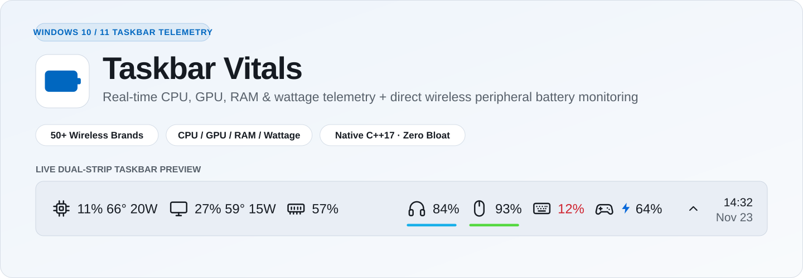
</picture>

<p><em>Dual-strip Windows taskbar overview — System Vitals on the left, wireless peripheral batteries beside the clock.</em></p>

</div>

---

> **Quick Start:** Grab **[TaskbarVitals-Setup](https://github.com/symNistaken/TaskbarVitals/releases/latest)** (`v2.1.1`) and pick **Install for me only** (no administrator rights needed), or extract the portable ZIP (`TaskbarVitals.exe` runs standalone). Packaging manifests for **winget** and **Scoop** live under [`installer/packaging/`](installer/packaging/README.md).
>
> *Note on first run:* Releases are unsigned open-source builds, so Defender SmartScreen may ask for **More info → Run anyway** (auto-updates verify offline ECDSA P-256 `SHA256SUMS.txt.sig` signatures).

---

## Why Taskbar Vitals 2.1?

Peripheral companion apps regularly eat hundreds of megabytes of RAM just to show a mouse percentage, while separate HUD overlays cover your game screen for temperatures and wattage. **Taskbar Vitals** replaces both with one lightweight native **C++17 / Win32** utility.

| Pillar | What Ships in 2.1.1 |
|---|---|
| **7-Metric System Telemetry** | Live **CPU** (`%`, `°C` on Intel &amp; AMD Ryzen `17h–1Ah`, RAPL `W`), **RAM** (`%` &amp; `Used/Total GB`), **GPU** (`%`, `°C`, `W` via NVML/ADLX/IGCL, **core &amp; VRAM clocks in `MHz`**), **VRAM** (`%` &amp; `GB`), **Storage / NVMe** (`°C`, busy `%`, `R/W MB/s`, capacity), **Network** (`↓`/`↑` + built-in HTTP Speed Test), and **Laptop Battery** (`±W`, `mWh`, runtime). |
| **85 Hardware &amp; Protocol Families** | Read-only battery, charging, and wake monitoring across **122 driver files** — gaming mice, wireless keyboards, headsets, AirPods/Beats AAP L2CAP, earbuds, gamepads, Bluetooth speakers, and Phone Link, backed by a read-only `HidEventListener` push-wake engine. |
| **Rich Sparkline Hover Cards** | Hovering any taskbar item opens a native Win32 graph card: a **3-minute real-time waveform + adapter clocks / throughput** for system hardware, or a **24-hour discharge curve + dashed runtime forecast** for peripherals. |
| **4 Strip Styles &amp; 19 Brand Colors** | Switch between **1-Row Colored Vector Icons**, **Compact 2-Row Layout**, **Icons Above Values**, or **Radial Battery Rings**. Dock strips independently on any monitor or combine them, with automatic contrast adaptation for **MyFinder** bars. |
| **Native 5-Tab Device Dashboard** | Inspect **Overview**, **Device Details**, **Battery Comparison** (`%/day`), **Charging History**, and **System Vitals** — plus 365-day **Battery Health** cycle wear tracking (`95% → 20%`) and 5-column CSV exports. |
| **100% Local &amp; ECDSA-Verified Updates** | Zero telemetry or accounts. Optional **Local JSON Pipe (`\\.\pipe\TaskbarVitals`)** restricts ACLs to your user SID; official auto-updates validate `SHA256SUMS.txt.sig` offline via Windows BCrypt (ECDSA P-256). |

---

## Taskbar Layouts & Live Sparkline Hover Cards

All captures below come directly from Windows 11 — zero synthetic mockups.

| 1-Row Taskbar Strips &amp; Hover Cards | Highlights |
|---|---|
| <p align="center"><br><em>System Vitals (left): CPU, RAM, GPU + 2055MHz clock, VRAM, SSD °C, Net ↓/↑</em></p><p align="center"><br><em>Wireless Batteries (clock): Razer headset 45%, Viper V3 Pro 35%, AULA 100%, phone 29% ⚡</em></p> | **Precision 1-Row + Live Graphs:** Colored vector glyphs, per-metric fill bars, and 19 brand accents. Hover any item for a live 3-minute system sparkline or 24-hour peripheral discharge curve. |
| <p align="center">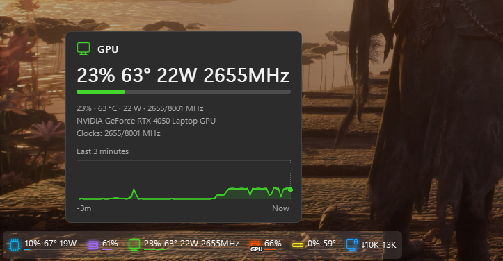<br><em>GPU Hover Card: core/VRAM clocks (2655/8001 MHz) &amp; 3-minute load sparkline</em></p> | <p align="center">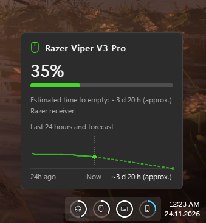<br><em>Device Hover Card: 24h curve, dashed forecast &amp; radial ring strip style</em></p> |

<details>
  <summary><strong>Compare Compact 2-Row, Stacked, and Radial Ring taskbar layout captures</strong></summary>
  <br>
  <table>
    <tr>
      <th>Layout Mode</th>
      <th>Windows Capture</th>
    </tr>
    <tr>
      <td><strong>Compact 2-Row Layout</strong><br>Packs 6–7 system vitals into roughly half the horizontal taskbar width.</td>
      <td align="center"></td>
    </tr>
    <tr>
      <td><strong>Icons Above Values (Narrower)</strong><br>Places crisp vector glyphs above telemetry strings and device percentages.</td>
      <td align="center">
        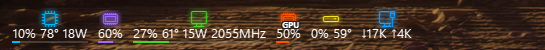<br><br>
        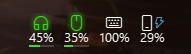
      </td>
    </tr>
    <tr>
      <td><strong>Ring Style (Battery Arcs)</strong><br>Minimalist circular arc gauges beside the clock with blue charging arcs.</td>
      <td align="center"></td>
    </tr>
  </table>
</details>

---

## 7-Metric System Telemetry Architecture

System vitals sample every **2 seconds** (configurable). Optional libraries (`pdh.dll`, `dxgi.dll`, `nvml.dll`, `amdadlx64.dll`, `ControlLib.dll`, `iphlpapi.dll`, `winmm.dll`) are delay-loaded on first use and freed immediately when disabled.

| Metric | Measured Values | Underlying Telemetry Path |
|---|---|---|
| **CPU** | Load `%`, package `°C`, package `W` | `GetSystemTimes` + Windows Energy Meter RAPL counters; optional package temp via isolated `TaskbarVitalsTemp.exe` helper using **PawnIO** (`IntelMSR` on Intel, SHA-256 verified `AMDFamily17` SMN on AMD Ryzen `17h–1Ah`, read-only). |
| **RAM** | Physical memory `%` and `Used / Total GB` | Direct `GlobalMemoryStatusEx` query with virtually zero overhead. |
| **GPU &amp; Clocks** | Engine `%`, `°C`, board `W`, **Core &amp; VRAM clocks (`MHz`)** | Auto-picks discrete/highest-VRAM adapter via DXGI, PDH `GPU Engine`, WDDM `D3DKMTQueryAdapterInfo`, NVIDIA **NVML** (`nvml.dll`), AMD **ADLX** (`amdadlx64.dll`), and Intel **IGCL** (`ControlLib.dll`). |
| **GPU Memory (VRAM)** | Dedicated VRAM `%` and `Used / Total GB` | PDH `GPU Adapter Memory` + DXGI adapter budget queries; independent toggle and strip ordering. |
| **Storage (NVMe / SSD)** | Drive `°C`, busy `%`, `R/W MB/s`, free/total capacity | Zero-admin `IOCTL_STORAGE_QUERY_PROPERTY` temperature (`≥65 °C` amber / `≥75 °C` red), PDH `% Disk Time` &amp; throughput counters, and `GetDiskFreeSpaceExW`. |
| **Network + Speed Test** | Live `↓`/`↑` throughput &amp; built-in HTTP Mbps test | `iphlpapi.dll` `GetIfTable2` counter deltas (skipping loopback, tunnel, filter, and disconnected NICs) plus a one-click WinHTTP speed test inside Settings &amp; Dashboard. |
| **Laptop Battery** | Percentage `%`, AC/charging icon, signed `±W`, runtime | `GetSystemPowerStatus` + `powrprof.dll` `CallNtPowerInformation(SystemBatteryState)`, instant `PBT_APMPOWERSTATUSCHANGE` refresh, hidden cleanly on desktops. |

**Temperature Colour Presets (`Settings → System`):** Switch between **Standard (`80 / 90 °C`)**, **Laptop (`85 / 95 °C`)**, or **Strict (`70 / 85 °C`)** with matching thermal alerts.

---

## Device Intelligence Dashboard & 365-Day Health

Open **Device dashboard...** from the **Batteries** tab or any device's `⋯` menu. All 5 native Win32 tabs (**Overview**, **Device Details**, **Battery Comparison**, **Charging History**, and **System Vitals**) share your dark/light theme:

| Overview | Battery Comparison (`%/day`) | Device Details &amp; 7-Day Trend |
|---|---|---|
| 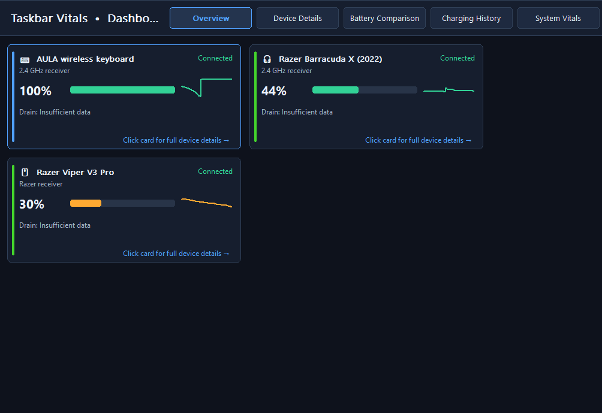 | 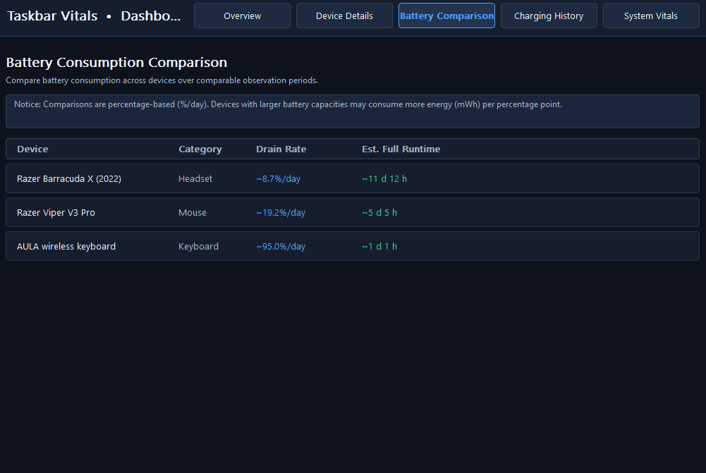 | 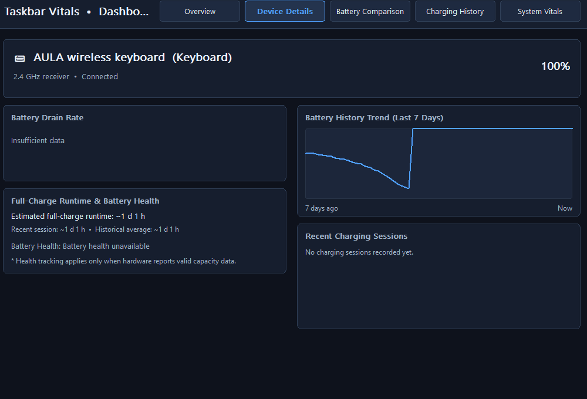 |

- **30-Day History &amp; CSV Export:** Each device's `⋯ → Battery history...` window charts **24h / 7d / 30d** curves, conservative time-to-empty estimates, and exports a 5-column CSV report.
- **365-Day Battery Wear Tracking:** Compares early-month vs recent full-charge runtime across observed `≥95% → ≤20%` discharge cycles to surface real battery degradation over time.

---

## Settings Panel, Gaming Alerts & Indicator Reference

Left-click any strip item to open the Windows 10/11 DPI-aware **Settings Panel** (**Shift + Click** opens the classic tray menu). Supports **21 built-in languages**.

| System &amp; Storage | Batteries &amp; Smart Alerts | Appearance &amp; General |
|---|---|---|
| <p align="center">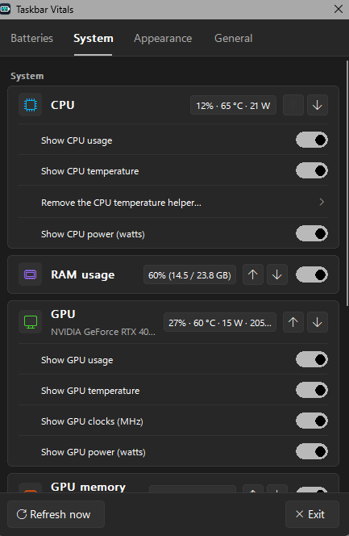<br><em><strong>System:</strong> Live pills, ↑/↓ strip ordering, CPU helper &amp; GPU MHz clocks</em></p><p align="center">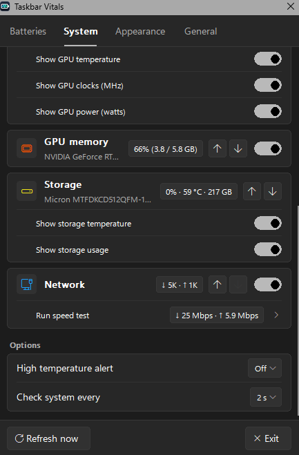<br><em><strong>VRAM, Storage &amp; Network:</strong> NVMe temps/GB, Speed Test &amp; thermal alerts</em></p> | <p align="center">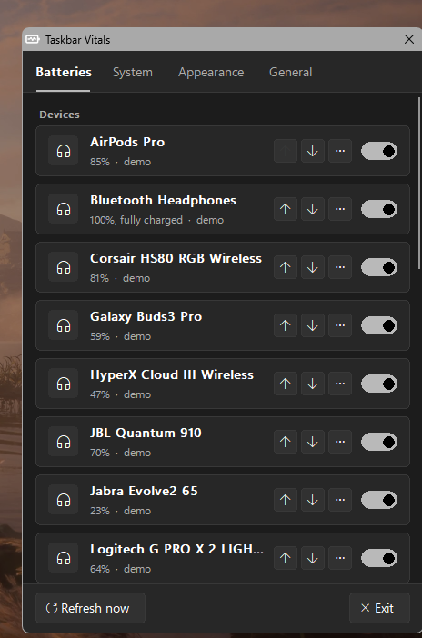<br><em><strong>Batteries:</strong> Device ordering, Dashboard shortcut &amp; per-device ⋯ actions</em></p><p align="center">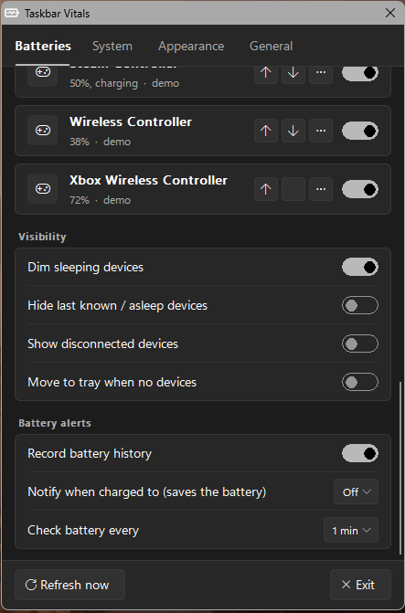<br><em><strong>Visibility &amp; Alerts:</strong> Dim sleeping gear, history &amp; charge-limit alerts</em></p> | <p align="center">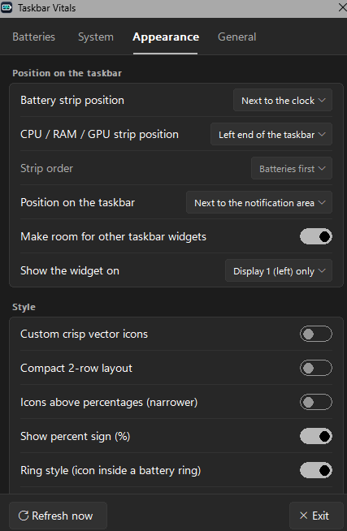<br><em><strong>Appearance:</strong> Dual-strip placement, vector icons, 2-row, stacked &amp; ring styles</em></p><p align="center">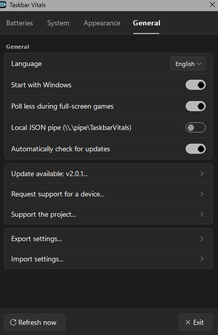<br><em><strong>General:</strong> Full-screen throttle, JSON pipe, signed updates &amp; Export/Import</em></p> |

<p align="center">
  <picture>
    <source media="(prefers-color-scheme: dark)" srcset="docs/readme/states-dark.svg">
    
  </picture>
</p>

### Gaming, Alert &amp; Customization Highlights

- **Full-Screen Game Poll Throttle (`Settings → General`):** Enabled by default (`SHQueryUserNotificationState` + fullscreen detection) to stretch wireless peripheral polling to ≥5 minutes while playing games.
- **Multi-Monitor Smart In-Game OSD (`Settings → Batteries`):** Click-through, non-focus-stealing low-battery banners default to **Only in full screen** (*Smart Auto* routes alerts to a free secondary monitor; or pick **Full screen (game monitor)** / **Always** and any corner). Borderless fullscreen works reliably; exclusive fullscreen DirectX modes may still sit above desktop overlays.
- **Audio Chimes, Evening Reminders &amp; Ignored Devices:** Optional Windows default chime (`winmm.dll`), daily **Evening charge reminder** (`20:00–23:00`), per-device **Notify when charged to** (`80%–100%`), one-click **Ignore this device...**, and JSON **Export / Import settings** (excluding Windows startup keys).

---

## Supported Hardware

> **Browse &amp; Search All 85 Families:** Open the **[Searchable Compatibility Matrix](https://symnistaken.github.io/TaskbarVitals/compatibility.html)** (backed by [`site/devices.json`](site/devices.json)) to filter by vendor, category, model, protocol, physical test status, or `VID:PID`. Run `TaskbarVitals.exe --dump` to inspect your IDs or `TaskbarVitals.exe --report` to request an unlisted device.

Taskbar Vitals communicates strictly in **read-only mode** over HID, USB, Bluetooth / AAP L2CAP, BLE, RFCOMM, or serial receivers, pairing polling with a read-only `HidEventListener` wake watcher:

| Category | Representative Families (`85` Total in Matrix) |
|---|---|
| **Mice** | Logitech, Razer, SteelSeries, Corsair, Pulsar, LAMZU, Endgame Gear, VAXEE, Finalmouse, WLMouse, ZOWIE, Glorious, Hitscan, Ninjutso, Arbiter Studio, ATK / VXE / VGN, MCHOSE, Kysona, DAREU, CROCIRIS / XIBERIA (`36F9:AA20`), IPI PIAO (`372E:1014`), Rapoo VT, RAWM, Incott, Scyrox, Sprime, Darmoshark, EWEADN, Machenike, Redragon / Sinowealth, MSI, Cooler Master, Fantech, Sharkoon, Zenith, Niceboy, Press Play |
| **Keyboards** | Logitech, Razer, ASUS ROG, Keychron (Bluetooth &amp; patched 2.4 GHz), NuPhy (`WH80` &amp; `Halo96 V2`), CHERRY MX 3.0S, AULA (`F75`–`F108 Pro`, `HERO 68 Air`), MCHOSE, ATK / VXE / VGN, Wobkey (`Rainy75 V2`) &amp; PMO / URX / EVO80 (`36B0`), SONiX (`AK820 MAX`, `EA75`, `F108 Pro`), Semico (`1A2C`), Redragon, DAREU, DARKRIM |
| **Headsets, Earbuds &amp; Speakers** | Apple AirPods / Beats (true **1% AAP L2CAP** via bridge drivers or BLE proximity), Sony Headphones (`WH-1000XM3–5`, `WF-1000XM3–5`, `LinkBuds` via RFCOMM), Anker Soundcore (RFCOMM), Samsung Galaxy Buds, Nothing / CMF Buds, ASTRO, PlayStation PULSE Explore (`054C:0ECC`), Sony INZONE, ROCCAT (`1E7D:3A3F`), SteelSeries Arctis &amp; GameBuds, HyperX, Razer BlackShark (`V2`/`V3`) &amp; Barracuda, Logitech (`G435` incl. Jieli `4C4A:4155`, `G735` `046D:0AD8`), JBL Quantum &amp; **Flip 7** (`0057:2107`), Marshall EMBERTON II, Audeze Maxwell / 2, Turtle Beach Gen 3, Alienware AW920H, Jabra GNP, AKG N9 Hybrid, Fractal Scape, Poly BT600, ATK (`N9 Pro/Ultra`, `Mercury`), MCHOSE V9, AULA A7Pro, VGN OMNISOUND, MOONDROP GM01 Pro, ENDORFY Viro, Google Fast Pair (`FE2C`), HeadsetControl 4.3.0 |
| **Controllers &amp; Phones** | Xbox Wireless / Bluetooth, PlayStation DualShock 4 / DualSense / Edge, Valve Steam Controller (`28DE`), Switch Pro (`057E:2009`), 8BitDo (`Ultimate 2/2C`, `Pro 2/3`), BigBigWon Armor X Pro (dongle + BLE), GameSir (`Nova`, `G7 Pro`, `Cyclone 2/Pro`, `Super Nova`, `Tarantula Pro`), Flydigi (`Vader 5 Pro`, `Apex 5`), BEITONG (`KP20`/`KP40D`), Android phones via Microsoft Phone Link, Generic HID |

<details>
  <summary><strong>Known limitations &amp; protocol caveats</strong></summary>

- **Crowded Windows 11 centered taskbars:** Extremely dense taskbar icon rows can approach the strip area; enable **Make room for other taskbar widgets** under Appearance when pairing with third-party bars.
- **Sleeping devices:** Inactive mice/keyboards may ignore queries until moved; their last valid percentage remains visible and dimmed (`graceSec` 30-minute default).
- **Microsoft Phone Link:** Reads local Windows 11 `StartMenuCompanion.json` cache; readings older than 3 hours appear dimmed.
- **Logitech `046D:C542` (C-U0019):** Exposes no HID++ battery queries (same constraint as Solaar).
- **Keychron keyboards:** Stock firmware exposes battery over Bluetooth only; 2.4 GHz requires the [QMK firmware patch](docs/keychron_keyboard_firmware/README.md).
- **GameSir Cyclone Pro (`3537:1015`):** Pair once over Windows BLE so Taskbar Vitals can poll service `0x8650` while playing on the 2.4 GHz dongle ([details](docs/gamesir_cyclone_pro.md)).
- **Single-client RFCOMM / COM links:** Only one app can hold Sony RFCOMM or ATK N9 serial COM ports at a time — if the official phone app or ATK HUB holds the link, Taskbar Vitals skips cleanly until free.
- **AirPods 1% AAP L2CAP:** Requires a Windows L2CAP bridge driver (`NTPodsAAP`, `PodPilotAap`, or `MagicAAP`); without one, Taskbar Vitals falls back to 10%-step BLE proximity ads.

</details>

---

## Installation, SmartScreen & Update Verification

| Package | Best For | Notes |
|---|---|---|
| **Setup Installer** (`TaskbarVitals-Setup-2.1.1.exe`) | Daily desktop use | Pick **Install for me only** (no admin rights) or **All users**. Includes Start menu shortcut &amp; uninstaller. |
| **Portable ZIP** (`TaskbarVitals-2.1.1-portable.zip`) | USB drives / custom folders | Extract and launch `TaskbarVitals.exe`. Bundled with `TaskbarVitalsTemp.exe` &amp; `headsetcontrol.exe`. |
| **winget / Scoop Templates** | Package managers | Manifests live under [`installer/packaging/`](installer/packaging/README.md). |

- **Seamless Legacy Migration:** Installing over an existing `WirelessBattery` or `BatteryHub` setup keeps all device aliases, alert thresholds, startup settings, 30-day battery logs, and 365-day health records intact.
- **Windows SmartScreen:** Releases are open-source binaries without a commercial Authenticode signature, so SmartScreen may show *"Windows protected your PC"*. Click **More info → Run anyway** and optionally verify against [`SHA256SUMS.txt`](https://github.com/symNistaken/TaskbarVitals/releases/latest).
- **ECDSA P-256 Offline Updater Verification:** Stable builds check GitHub Releases anonymously after startup and every 24 hours. Before running any update, `TaskbarVitals.exe` verifies `SHA256SUMS.txt.sig` offline against the embedded ECDSA P-256 public key (`src/update_public_key.h`) via Windows BCrypt and verifies the setup binary hash under an exclusive lock. Zero device or user telemetry ever leaves your PC.
- **Network connections:** The app only connects out in these cases, and never sends device readings, usage data, or account details:
  - *Update check* (official stable builds only): `api.github.com`, about 30 seconds after startup and then at most once every 24 hours. It sends a normal HTTPS request, so GitHub sees your IP address and the app version in the user agent. Turn it off with **Automatically check for updates** in the tray menu or Settings. An update is only downloaded (from `github.com` hosts) after you click **Download and install**.
  - *Speed test*: `speed.cloudflare.com`, only when you click **Run speed test** (tray menu, Settings, or Dashboard). It downloads about 10 MB and uploads 2 MB of filler data. Cloudflare sees your IP address. Never clicking it means it never connects.

---

## CLI & Local JSON Pipe

Run any option from PowerShell or Command Prompt (output stays in English for issue reports):

| Flag | Behavior |
|---|---|
| `TaskbarVitals.exe --list` | Print detected peripherals and battery readings, then exit. |
| `TaskbarVitals.exe --json` | Print peripheral readings as a structured JSON array, then exit. |
| `TaskbarVitals.exe --text` | Print a concise single-line summary for YASB / Rainmeter. |
| `TaskbarVitals.exe --dump` | Dump HID collections, USB devices, Bluetooth links &amp; AAP diagnostics to `%TEMP%`. |
| `TaskbarVitals.exe --events` | Monitor wireless receiver HID push-wake events for 60 seconds. |
| `TaskbarVitals.exe --report` | Open **Request support for a device** prefilled with your hardware IDs. |
| `TaskbarVitals.exe --demo` | Display synthetic multi-brand devices for layout testing (touches no history). |
| `TaskbarVitals.exe --trace` | Write per-poll timing traces to `%TEMP%\wirelessbattery-trace.log`. |
| `TaskbarVitals.exe --quit` | Request a running Taskbar Vitals instance to exit cleanly. |

Enable **Local JSON pipe (`\\.\pipe\TaskbarVitals`)** under **Settings → General** for Stream Deck, Rainmeter, or automation scripts (ACL restricted to your user SID, remote clients rejected):

```powershell
$pipe = [System.IO.Pipes.NamedPipeClientStream]::new('.', 'TaskbarVitals', [System.IO.Pipes.PipeDirection]::In)
$pipe.Connect(1000)
$reader = [System.IO.StreamReader]::new($pipe)
$snapshot = $reader.ReadToEnd() | ConvertFrom-Json
$reader.Dispose(); $pipe.Dispose()
$snapshot.devices
$snapshot.system
```

---

## Building from Source

### Windows (MSYS2 MINGW64 / Command Prompt)

Uses **C++17 + Win32** (`pacman -S mingw-w64-x86_64-gcc make` in MSYS2 **MINGW64**, or `g++` + `windres` on `PATH` with `build.bat`):

| Goal | Command |
|---|---|
| Build app &amp; temp helper | `make -j12` (MSYS2) or `build.bat 2.1.1 stable` (cmd) |
| Versioned test build | `make -j12 VERSION=2.1.1 CHANNEL=test` |
| Run full C++ test suite | `make test VERSION=2.1.1 CHANNEL=test` |
| Package Setup &amp; Portable ZIP | `powershell -NoProfile -ExecutionPolicy Bypass -File installer\build-installer.ps1 -Version 2.1.1` *(requires [Inno Setup 6](https://jrsoftware.org/isinfo.php))* |

### Linux (Experimental)

Reuses core read-only HID drivers over `hidraw` with a **GTK4 / StatusNotifierItem** tray widget (`linux/`, `src/linux/`, `src/linux_paths.h`):

```sh
# Fedora: sudo dnf install gcc-c++ make gtk4-devel cairo-devel
# Ubuntu: sudo apt install g++ make libgtk-4-dev libcairo2-dev
./build-linux.sh
./taskbar-vitals --list
./build-linux.sh test

# Grant read-only hidraw access (remove any legacy 70/99-wireless-battery.rules first)
sudo cp linux/70-taskbar-vitals.rules /etc/udev/rules.d/
sudo udevadm control --reload-rules && sudo udevadm trigger
```

---

## Localization &amp; Contributing

Taskbar Vitals ships **21 built-in languages**: `English`, `العربية`, `Deutsch`, `Español`, `فارسی`, `Français`, `עברית`, `Magyar`, `Italiano`, `日本語`, `한국어`, `Polski`, `Português (Brasil)`, `Русский`, `Svenska`, `ภาษาไทย`, `Türkçe`, `Українська`, `Tiếng Việt`, `简体中文`, `繁體中文`.

> **Help wanted.** Taskbar Vitals is maintained by one person. Phrases added in 2.1 were machine-translated for every language except English and Turkish; they sit at the end of each file in [`lang/`](lang/) under a "please review" comment. If you speak one of these languages, corrections are very welcome as a pull request or an [issue](https://github.com/symNistaken/TaskbarVitals/issues). The same goes for bugs and devices that show a wrong or missing battery level: open an issue and attach the output of `TaskbarVitals.exe --report`.

- **Customize locally:** Open **Settings → General → Language → Add your own language...** to copy `_template.txt` in `%APPDATA%\WirelessBattery\lang\` to `<code>.txt`.
- **Contribute:** See [`CONTRIBUTING.md`](CONTRIBUTING.md) for driver architecture, test registration, and security rules, and [`SECURITY.md`](SECURITY.md) for vulnerability disclosure &amp; signing notes.

---

## Support the Project

Taskbar Vitals is free, open-source, and ad-free:

- **Star the repository** on GitHub so more Windows hardware enthusiasts can find it.
- **Request or verify hardware** via `TaskbarVitals.exe --report` or [Issue Templates](https://github.com/symNistaken/TaskbarVitals/issues/new/choose).
- **Buy Me a Coffee:** Support test hardware purchases and releases at **[buymeacoffee.com/symnistaken](https://buymeacoffee.com/symnistaken)** (also linked under **Settings → General → Support the project...**).

---

## Credits &amp; License

- **Bundled / Integrated Open-Source Tools:** [HeadsetControl](https://github.com/Sapd/HeadsetControl) (GPL-3.0, headset fallback) and [PawnIO](https://pawnio.eu) `IntelMSR` + `AMDFamily17` modules (LGPL-2.1+, read-only CPU package temperature).
- **Project Heritage:** Built under **GPL-3.0-or-later** atop the public [BatteryHub](https://github.com/krisgfx9/Wireless-Device-Battery-Monitor) codebase by `krisgfx9` and community contributors, along with open-source protocol research credited across driver headers.

Licensed under the **[GNU General Public License v3.0 or later](LICENSE)**.
