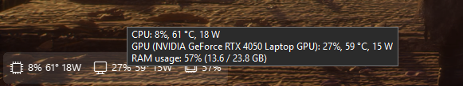
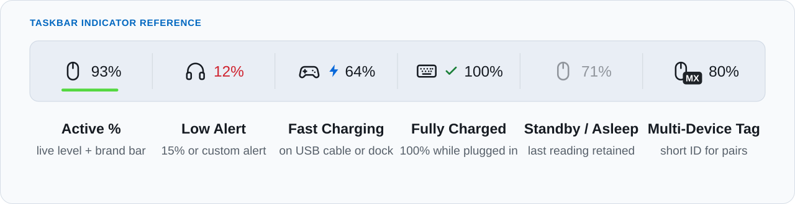

<div align="center">

<picture>
  <source media="(prefers-color-scheme: dark)" srcset="docs/readme/logo-dark.svg">
  
</picture>

<h1>Taskbar Vitals</h1>

<p>
  <strong>Live CPU, RAM, GPU &amp; wattage telemetry alongside wireless peripheral battery levels — natively on your Windows taskbar.</strong>
</p>

<p>
  <a href="https://github.com/symNistaken/TaskbarVitals/releases/latest"></a>
  <a href="https://github.com/symNistaken/TaskbarVitals/actions/workflows/build.yml"></a>
  <a href="https://github.com/symNistaken/TaskbarVitals/releases"></a>
  <a href="LICENSE"></a>
  <a href="https://github.com/symNistaken/TaskbarVitals/issues/new/choose"></a>
  <a href="https://buymeacoffee.com/symnistaken"></a>
</p>

<p>
  <a href="#installation">Install</a> ·
  <a href="#why-taskbar-vitals">Features</a> ·
  <a href="#live-system-telemetry-cpu--ram--gpu--watts--temps">System Vitals</a> ·
  <a href="#supported-hardware">Supported Hardware</a> ·
  <a href="#cli--automation">CLI</a> ·
  <a href="#support-the-project">Support</a> ·
  <a href="SECURITY.md">Security</a>
</p>

<picture>
  <source media="(prefers-color-scheme: dark)" srcset="docs/readme/banner-dark.svg">
  
</picture>

<p><em>Illustrative taskbar preview — sample CPU, GPU, RAM and wireless peripheral readings.</em></p>

</div>

---

> **Quick Start:** Download **[TaskbarVitals-Setup](https://github.com/symNistaken/TaskbarVitals/releases/latest)** and pick **Install for me only** (no administrator rights required), or grab the portable ZIP from the same release page.
>
> **Migrating from WirelessBattery / BatteryHub:** Installing Taskbar Vitals over an existing copy automatically preserves your saved device aliases, alert thresholds, startup preference, and 30-day battery history. Taskbar Vitals is an independent GPL-3.0-or-later project built from the public BatteryHub codebase and expanded with live system monitoring, a redesigned settings panel, custom strip layouts, and signed updates.

---

## Why Taskbar Vitals?

Most peripheral apps eat hundreds of megabytes of RAM just to tell you your mouse is at 40%, while separate overlays clutter your screen to show CPU/GPU metrics. **Taskbar Vitals** replaces both with a single tiny native C++17 / Win32 binary.

| Pillar | What You Get |
|---|---|
| **Live System Vitals Strip** | Real-time **CPU** usage (%) and package power (W), **RAM** usage (% and GB), and **GPU** load (%), temperature (°C), VRAM usage (% and GB), and board wattage (W via NVML / ADLX / IGCL), with custom **System item order**. |
| **Direct Peripheral Engine** | Read-only battery & charging status for wireless mice, keyboards, headsets, earbuds, gamepads, and linked Android phones across **75+ brand/protocol families** without manufacturer bloatware. |
| **Dual-Strip Taskbar Layout** | Keep **System Vitals** pinned to the **Left end of the taskbar** while keeping **Peripheral Batteries** **Next to the clock** — or combine both into one strip, target specific monitors, or switch to per-device tray icons. |
| **15 Brand Color Themes & Aliases** | Automatic color-coded level bars for Razer, Logitech, SteelSeries, Corsair, ROG, ZOWIE, HyperX, PlayStation, Xbox, Samsung, Apple, Jabra, JBL, Cooler Master, and Steam, plus custom device names (up to 64 chars). |
| **Smart Alerts & 30-Day Charts** | Per-device low-battery alerts (5%–40% thresholds with smart re-arm), a DPI-aware native **24h / 7d / 30d** discharge chart with conservative time-to-empty estimation, and 365-day **Battery health** wear tracking across full discharge cycles. |
| **100% Local & Signed Updates** | Zero accounts, zero cloud telemetry. Official Windows updates verify ECDSA P-256 `SHA256SUMS.txt.sig` signatures offline before executing an installer. |

---

## Live System Telemetry (CPU · RAM · GPU · Watts · Temps)

Enable hardware vitals without running heavyweight overlays or background suites. **Taskbar Vitals** samples metrics every 2 seconds on demand and keeps your taskbar clean:

| Dual-Strip Taskbar Captures | Live Hover Tooltip |
|---|---|
| <p align="center"><strong>Left end (System Vitals):</strong><br></p><p align="center"><strong>Next to the clock (Wireless Batteries):</strong><br></p> | <p align="center"></p> |

| Component | What Is Measured | How It Works Under the Hood |
|---|---|---|
| **Processor (CPU)** | Core load (`%`), package temperature (`°C`), and package wattage (`W`) | Load via `GetSystemTimes`; RAPL wattage via Windows **Energy Meter** PDH counters; optional CPU package temperature via the isolated `TaskbarVitalsTemp.exe` helper (`PawnIO` `IntelMSR` for Intel, `AMDFamily17` SMN for AMD Ryzen, read-only). |
| **Graphics (GPU & VRAM)** | Engine usage (`%`), temperature (`°C`), board wattage (`W`), and dedicated VRAM (`%` & `GB`) | Automatically selects the adapter with the largest dedicated memory (discrete GPU on dual-GPU laptops) via DXGI, PDH (`GPU Engine` / `GPU Adapter Memory`), WDDM `D3DKMTQueryAdapterInfo`, NVIDIA NVML (`nvml.dll`), AMD ADLX (`amdadlx64.dll`), and Intel IGCL (`ControlLib.dll`). |
| **Memory (RAM)** | Physical memory percentage + `Used / Total GB` in the tooltip and System card | Native `GlobalMemoryStatusEx` call with virtually zero CPU cost. |
| **Laptop Battery** | Charge percentage (`%`), charging / full state, and remaining runtime in the tooltip | Native `GetSystemPowerStatus` call; disabled in Settings on desktop PCs without a system battery. |
| **Network** | Live download (`↓`) and upload (`↑`) throughput (`B/s` – `GB/s`) | Reads `GetIfTable2` interface counters from delay-loaded `iphlpapi.dll` (excluding loopback, tunnel, filter, and disconnected adapters); freed immediately when disabled. |
| **Thermal Warnings & Cleanup** | Configurable temperature colour thresholds (**Standard 80/90 °C**, **Laptop 85/95 °C**, **Strict 70/85 °C**) shifting text to orange/red, plus optional high-temperature alerts | Performance counters and optional DLLs (`pdh.dll`, `dxgi.dll`, `nvml.dll`, `amdadlx64.dll`, `ControlLib.dll`, `iphlpapi.dll`) are delay-loaded on first use and freed immediately when disabled. |

---

## Redesigned Settings Panel & Dual-Strip Layout

Click anywhere on the taskbar strip to open the modern, DPI-aware **Settings Panel** (or **Shift + Click** for the classic context menu). Both strips and the panel follow Windows 10/11 dark and light themes automatically.

| System Telemetry & Connected Devices | Appearance & General Preferences |
|---|---|
| <p align="center"><br><em><strong>System:</strong> Live card summary badges, ↑/↓ indicator ordering, and per-metric toggles</em></p> | <p align="center"><br><em><strong>Appearance:</strong> Dual-strip placement, display selection, and visual style</em></p> |
| <p align="center"><br><em><strong>Batteries:</strong> Device cards, ↑/↓ ordering, ⋯ per-device menu, and visibility toggles</em></p> | <p align="center"><br><em><strong>General:</strong> Language, startup, updates, device support, and project link</em></p> |

<details>
  <summary><strong>View Batteries tab visibility, history &amp; charge-limit alert settings</strong></summary>
  <p align="center"></p>
</details>

<p align="center">
  <picture>
    <source media="(prefers-color-scheme: dark)" srcset="docs/readme/states-dark.svg">
    
  </picture>
</p>

### Strip Indicators & Settings Tabs

| Tab / Area | Controls & Behavior |
|---|---|
| **Batteries** | Reorder (`↑`/`↓`), toggle, or customize devices via `⋯` (rename up to 64 chars, per-device 5%–40% alerts, 30-day **Battery history** with CSV export and 365-day **Battery health** wear tracking, `Ignore this device...`), plus **Visibility** (`Dim sleeping devices`, `Hide last known / asleep devices`, `Show disconnected devices`, `Move to tray when no devices`), **Battery alerts** (`Record battery history`, `Notify when charged to`, `Evening charge reminder`, `Alert sound`, `In-game alerts`, `In-game alert corner`, `Check battery every`), and **Ignored devices...**. |
| **System** | Live summary pills and `↑`/`↓` ordering across **CPU** (`Show CPU usage`, `Show CPU temperature`, CPU temp helper setup/removal, `Show CPU power (watts)`), **GPU** (`Show GPU usage`, `Show GPU temperature`, `Show GPU power (watts)`), **RAM usage**, **GPU memory**, **Laptop battery**, and **Network** (`Show network speed`), plus **Options** (`Temperature colours` presets, `High temperature alert`, and `Check system every`). |
| **Appearance** | **Display mode** (`Show on the taskbar` / `Show as tray icons`), **Position on the taskbar** (`Battery strip position`, `CPU / RAM / GPU strip position`, `Strip order`, `Position on the taskbar`, `Make room for other taskbar widgets`, `Show the widget on`), and **Style** (`Icons above percentages`, backdrop plate, 15 `Brand colors`). |
| **General** | `Language` (20 built-in languages), `Start with Windows`, `Poll less during full-screen games` (stretches battery polling to at least 5 minutes while active full-screen apps run), `Local JSON pipe (\\.\pipe\TaskbarVitals)` (opt-in read-only live snapshot pipe for Stream Deck / Rainmeter / scripts), `Automatically check for updates`, `Check for updates...`, `Export settings...`, `Import settings...` (JSON backup, excluding Windows startup registration), `Request support for a device...`, and `Support the project...`. |
| **Indicator States** | Red `%` marks ≤15%; blue `⚡` indicates active charging; green `✓` marks 100% on power; dimmed items retain the last reading while asleep; `×` marks explicit offline links; small badges distinguish identical devices. |

---

## Supported Hardware

Taskbar Vitals communicates strictly in **read-only mode** via HID, USB, Bluetooth, or RFCOMM. A brand name alone does not guarantee every model works — verify your model, connection mode, or receiver `VID:PID` (`TaskbarVitals.exe --dump`) below.

| Category | Representative Supported Brands & Ecosystems |
|---|---|
| **Gaming Mice** | Logitech, Razer, SteelSeries, Corsair, Pulsar, LAMZU, Endgame Gear, VAXEE, Finalmouse, WLMouse, ZOWIE, Glorious, Hitscan, Ninjutso, Arbiter Studio, ATK / VXE, MCHOSE, Kysona, DAREU, Rapoo VT, RAWM, Incott, Scyrox, Sprime, Darmoshark, EWEADN, Machenike, Redragon, MSI, Cooler Master, Fantech, Sharkoon, Zenith, Motospeed, Delux, Ajazz, HECATE, Taidu, Wraith, Niceboy |
| **Wireless Keyboards** | Logitech, Razer, ASUS ROG, Keychron (Bluetooth & patched 2.4 GHz), NuPhy, CHERRY MX 3.0S, AULA, MCHOSE, ATK / VGN / VXE, PMO / WOBKEY / URX / EVO80 (`36B0`), SONiX (`AK820 MAX`, `AK820 Pro`, `EA75`, `F108 Pro`, `P75`, etc.), Semico (`X98`, `AK820 Max Plus`), Redragon (`Horus Pro`, `K742B`), DAREU (`A84`, `EK75 Pro`), Royal Kludge, DARKRIM |
| **Headsets & Earbuds** | Apple AirPods / Beats, Samsung Galaxy Buds, Nothing / CMF Buds, ASTRO (`A50 X / Gen 5 / Gen 4 / Gen 3 / A20`), Sony INZONE (`H9 II`, `H5`, `Buds`), SteelSeries Arctis & GameBuds, HyperX Cloud & Stinger, Razer BlackShark & Barracuda, Logitech G & G435, Corsair Void / Virtuoso / HS, JBL Quantum, Audeze Maxwell / 2, Turtle Beach Stealth 700 Gen 3, Alienware AW920H, Jabra GNP, AKG N9 Hybrid, Fractal Scape, Poly BT600, ATK N9 / Mercury, MCHOSE V9, AULA A7Pro, VGN OMNISOUND, MOONDROP GM01 Pro, ENDORFY Viro, Google Fast Pair, HeadsetControl 4.3.0 |
| **Controllers & Phones** | Xbox Wireless / Bluetooth, PlayStation DualShock 4 / DualSense / Edge, Switch Pro (`057E:2009`), 8BitDo (`Ultimate 2` / `2C` / `Pro 2/3`), GameSir (`Nova`, `G7 Pro`, `Cyclone 2`, `Cyclone Pro`, `Super Nova`, `Tarantula Pro`), Flydigi (`Vader 5 Pro`, `Apex 5`), BEITONG (`KP20`, `KP40D`), Android phones via Microsoft Phone Link, Generic HID Battery |

> **Full A–Z Hardware & Protocol Compatibility Matrix:** Browse and filter all 78 supported vendor &amp; fallback families by brand, model, protocol, category, or `VID:PID` on the **[Searchable Compatibility Page](https://symnistaken.github.io/TaskbarVitals/compatibility.html)** (backed by [`site/devices.json`](site/devices.json)).
>
> Run `TaskbarVitals.exe --dump` to find your device's exact `VID:PID`, or `TaskbarVitals.exe --report` to request support for an unlisted model.

<details>
  <summary><strong>Hardware-verified models (48 physical tests recorded)</strong></summary>

Confirmation covers the noted connection mode and percentage reading; not every charging or sleep transition was necessarily exercised.

- **Keyboards:** AJAZZ AK820 MAX (`05AC:024F`), AULA HERO 68 Air (`372E:106C`), CHERRY MX 3.0S Wireless (`046A:00EA` / `00E3`), DAREU EK75 Pro (`260D:0042` / `0046`), EPOMAKER EA75 (`05AC:024F` — no charging state; USB power may spike to 100%), Feker Alice80 (`320F:5088`), Keychron K5 Max (`3434:0A50`, patched firmware), NuPhy WH80 (`19F5:A011` / `324A`), Redragon K1NG M999 (`320F:226F`), ATK Z87 (`373B:1012`), MCHOSE G75 V2 (`3837:3033`), MCHOSE K87 V3 (`3837:1015`).
- **Mice:** AULA SC580 (`088D:062E` / `089D:062F`), AULA X9 Ultra (`320F:22A0`), CHERRY XTRFY 1K (`046A:0330`), Chimera V2 (`3554:F512`), Cooler Master MM712, Corsair Dark Core RGB Pro SE (`1B1C:1BDC`), Corsair Sabre V2 Pro Ultralight (`1B1C:2B2A`), Corsair Scimitar Elite SE Wireless (`1B1C:2B00`), DAREU A950 Wing (`260D:1154` / `1196`), DAREU A980 Pro (`260D:1131` / `1148`), DAREU EM901X (`260D:1074` / `1090`), DARKRIM SHADOW (`3654:6901`), Delux M800 Pro (`248A:5B2F`), Fantech Helios Go XD5 (`25A7:FA7C`), Fantech Raigor III (`1EA7:0066`), Finalmouse Starlight X, Finalmouse UltralightX (`361D:0100`), Glorious Model O Wireless, HECATE G5M PRO (`35BB:D3FB`), HyperX Pulsefire Haste (`03F0:028E` / `048E`), HyperX Pulsefire Haste 2 / Mini (`03F0:0F98`) &amp; 2 Core (`03F0:0AB5`), Inphic IN10R MAX model `73` (`1D57:FA65`), Machenike L7 Arctic / Mix (`248A:FF4C` / `FF4E`), MCHOSE G3 V2 (`3837:4245` / `418C`), MCHOSE K7 Ultra (`3837:1001`), MCHOSE K7 V2 Ultra+ (`3837:1014` / `4028`), MCHOSE L7 Ultra, MSI CLUTCH GM31 (`0DB0:0D3C`), MSI VERSA 300 ELITE (`0DB0:9E22`), Niceboy MW400 (`248A:FA02`), Ninjutso Sora V2 (`1915:AE1C` / `AE11`), Ninjutso Ten Air (`093A:EB01` / `E020`), Press Play ICARUS V2 (`7768:6434` / BT), Rapoo VT3 Max Gen 2 (`24AE:1417` / `4617`) &amp; VT9 Gen 2, RAWM Leviathan V4 (`1915:2346`), Redragon M602-KS (`258A:002F`), Redragon M915RGB-WL (`25A7:FA07`), Redragon M916 Pro 1K (`3554:F55D`), Sprime PM1 (`1915:AC1C`), SteelSeries Aerox 3 CS2 Dragon Lore (`1038:1878` / `187A`), SteelSeries Rival 650 (`1038:1726` / `172B`), Taidu TSG808 (`3554:F5D5`), WLMouse YING Magnesium (`36A7:A874`), Zenith Pro (`260D:1114`).
- **Headsets, Earbuds &amp; Microphones:** AirPods Max (`200A`), AirPods Pro 3 (`2027`), AKG N9 Hybrid (`0ECB:20D9`), Akko Air 01 (`3151:5006`), Akko V9 Dash Pro / Dash V9 Ultra (`38EE:000C` / `000F`), Alienware AW920H (`413C:A515`), ASTRO A50 X (`046D:0B0B`) / Gen 4 (`9886:002C`) / Gen 3 (`9886:0015`), ATK N9 Ultra (`373B:1204`), Audeze Maxwell 2 (`3329:4B29`), AULA A7Pro (`38A6:0001`), HyperX Cloud Core DTS (`0951:173F`), HyperX Cloud III Wireless, HyperX Cloud Stinger Core (`0951:1713` / `03F0:0A8E`), Jabra Evolve3 75 (Link 390 `0B0E:2E51`), JBL Quantum 350 (`0ECB:206B`) &amp; Quantum 650, MAONO PD200W (`352F:040E`), MCHOSE V9 Pro (`291D:385D`) &amp; V9 Pro 2 (`3837:6011`), MOONDROP GM01 Pro (`35D8:0133`), Nothing Ear (3a), Razer Barracuda X 2022 (`1532:054E` / `0550`), Razer BlackShark V3 X (`1532:057D`), SteelSeries Arctis Nova Pro (`1038:225D`), VGN OMNISOUND (`372E:10BB`).
- **Controllers &amp; Phones:** 8BitDo Ultimate 2 (`2DC8:310B`), Flydigi Apex 5 (`37D7:2501`), GameSir G7 Pro ZZZ (`3537:105E`), GameSir Super Nova (`3537:103E`), GameSir Tarantula Pro (`057E:2009` Switch mode), BEITONG KP20 (`20BC:5128`), Nothing Phone (4a) Pro (Phone Link).

</details>

---

## Known Limitations & Protocol Caveats

- **Crowded Windows 11 centered taskbars:** Extremely full taskbars can cause app buttons to reach the widget area. On Windows 10, Taskbar Vitals narrows the task-button region automatically.
- **Sleeping devices:** Sleeping mice/keyboards may not respond to queries. Their last reading stays visible and dimmed (configurable in Settings), with a 30-minute retention grace window for Logitech receivers and similar sleeping links.
- **Microsoft Phone Link:** Reads `%LOCALAPPDATA%` companion data (`StartMenuCompanion.json`), which is an undocumented Windows 11 format. Cards older than 3 hours appear dimmed.
- **In-game alerts (OSD):** On multi-monitor setups, Smart Auto (`Only in full screen`) places the lightweight corner overlay on a free side monitor so the game HUD stays clear, and you can also target the game monitor explicitly. It appears over borderless full-screen games and desktop apps, but may not be visible over games running in exclusive full-screen mode.

<details>
  <summary><strong>Device-specific protocol limits &amp; unsupported hardware notes</strong></summary>

- **Logitech `046D:C542` (C-U0019 receiver):** Does not expose HID++ battery queries (only standard mouse + vendor report ID 5); unsupported by both Taskbar Vitals and Solaar.
- **Keychron keyboards:** Stock firmware exposes battery only over Bluetooth; 2.4 GHz / USB requires the [QMK firmware patch](docs/keychron_keyboard_firmware/README.md).
- **Rapoo VT mice:** Passive push protocol; polling can wait up to 4 seconds per matching interface. Supports Nordic 54L report `07` and legacy `BB` (`VT3 Pro` / `VT1 Pro Max`); `CH584` (`08`) and MT/M-series office mice are excluded.
- **RAWM:** Only `Leviathan V4` (`1915:2346`) is hardware-tested; `Leviathan V4 GT` / `NYX60` (`373E`, HUB 3.0) and RAWM HS keyboards use different protocols.
- **GameSir Cyclone Pro:** The `3537:1015` dongle carries no battery field; pair the pad once over Windows Bluetooth LE so Taskbar Vitals can poll BLE service `0x8650` every 2 minutes while you play on 2.4 GHz ([details](docs/gamesir_cyclone_pro.md)).
- **Flydigi (`Vader 5 Pro` / `Apex 5`):** Coarse 20% steps via `FFA0:0001`; Bluetooth and other models (e.g., `Apex 6`) are not covered.
- **Currently unsupported models:** HECATE G2 Wireless 7.1 (`35BB:A009`/`A209`), Baseus AeQur GH02 (`10D6:4802` 2.4 GHz; works over Bluetooth), Weikav Lucky65 v1 (`0603:0351`), Razer Kraken, non-listed Barracuda/Pulsefire/MSI models, and Xbox Wireless Headset on the Xbox Wireless Adapter (works over Bluetooth).

</details>

---

## Installation & Signed Updates

| Edition | Recommended For | Notes |
|---|---|---|
| **Setup Installer** | Standard desktop installs | Choose **Install for me only** (no admin rights) or **All users**. Includes Start menu shortcut &amp; uninstaller. |
| **Portable ZIP** | USB drives / zero-install folders | Extract `TaskbarVitals-<version>-portable.zip` and run `TaskbarVitals.exe`. No external runtime needed. |

**Windows setup tips:**
- **SmartScreen:** Releases are open-source and not commercially code-signed. If SmartScreen prompts, select **More info → Run anyway**, or [build from source](#building-from-source).
- **Windows 11 Tray Overflow:** In tray mode, move icons out of `^` via **Settings → Personalization → Taskbar → Other system tray icons**.
- **Ignoring a Device:** Choose `⋯ → Ignore this device...` on any device card (or add comma-separated `VID:PID` entries from `--dump` to `IgnoreDevices` under `HKCU\Software\WirelessBattery`), and unignore anytime under **Settings → Batteries → Ignored devices...**. Drawing tablets are ignored automatically.

### Signed Auto-Updater (Windows)

Official stable releases check GitHub Releases 30 seconds after startup and every 24 hours (disable anytime under **Settings → General**). No device or battery information ever leaves your PC.

1. **Check** — Queries GitHub's public API anonymously over HTTPS.
2. **Choose** — Notifies inside Settings only; nothing installs without clicking **Download and install**.
3. **Verify** — Validates `SHA256SUMS.txt.sig` offline against the maintainer's ECDSA P-256 public key (`src/update_public_key.h`), then checks file size and SHA-256 under an exclusive lock.
4. **Install** — Runs the verified setup, preserves settings &amp; startup registration, and relaunches cleanly.

---

## CLI & Automation

Run from Command Prompt or PowerShell (diagnostic output stays in English for issue reports):

| Option | Behavior |
|---|---|
| `TaskbarVitals.exe --list` | Print detected peripherals and battery levels, then exit. |
| `TaskbarVitals.exe --json` | Print peripheral readings as a single JSON array, then exit. |
| `TaskbarVitals.exe --dump` | Print HID collections, USB devices, and Bluetooth entries; saves a diagnostic file in `%TEMP%`. |
| `TaskbarVitals.exe --report` | Open **Request support for a device** with prefilled hardware details. |
| `TaskbarVitals.exe --demo` | Display synthetic devices for screenshots and layout testing (does not touch history). |
| `TaskbarVitals.exe --quit` | Request a running instance to exit cleanly. |

Example `--json` output (`graceSec` indicates how long sleeping readings stay visible):

```json
[{"key":"kysona:373B:1085","name":"CX Wireless mouse","via":"2.4 GHz receiver","kind":"mouse","percent":85,"level":"","detail":"","charging":false,"asleep":false,"connected":true,"millivolts":4029,"graceSec":1800}]
```

With **Local JSON pipe (`\\.\pipe\TaskbarVitals`)** enabled under **Settings → General**, external tools (Stream Deck, Rainmeter, Home Assistant scripts) can read live device + system telemetry from Windows in PowerShell without spawning a new poll:

```powershell
$pipe = [System.IO.Pipes.NamedPipeClientStream]::new('.', 'TaskbarVitals', [System.IO.Pipes.PipeDirection]::In)
$pipe.Connect(1000)
$reader = [System.IO.StreamReader]::new($pipe)
$snapshot = $reader.ReadToEnd() | ConvertFrom-Json
$reader.Dispose(); $pipe.Dispose()
$snapshot.devices
$snapshot.system
```

---

## Building from Source

### Windows (MSYS2 MINGW64 / Command Prompt)

Uses C++17, Win32, and MinGW-w64 (`pacman -S mingw-w64-x86_64-gcc make` in MSYS2 **MINGW64**), or plain Command Prompt (`build.bat`) with `g++` and `windres` on `PATH`:

| Goal | Command |
|---|---|
| Development build | `make -j12` (MSYS2) or `build.bat` (cmd) |
| Versioned test-channel build | `make -j12 VERSION=2.0.0 CHANNEL=test` |
| Run full regression &amp; updater tests | `make test VERSION=2.0.0 CHANNEL=test` |
| Build installer &amp; portable ZIP | `powershell -File installer\build-installer.ps1 -Version 2.0.0` *(requires [Inno Setup](https://jrsoftware.org/isinfo.php))* |

`TaskbarVitals.exe` runs standalone; without `headsetcontrol.exe` beside it or on `PATH`, only HeadsetControl-fallback models are omitted.

### Linux (Experimental)

Reuses core read-only HID drivers over `hidraw` with a GTK4 StatusNotifierItem tray icon (`linux/` and `src/linux/`):

```sh
# Fedora: sudo dnf install gcc-c++ make gtk4-devel cairo-devel
# Ubuntu: sudo apt install g++ make libgtk-4-dev libcairo2-dev
./build-linux.sh
./taskbar-vitals --list
./build-linux.sh test

# Grant hidraw permissions (remove any older 99-wireless-battery.rules or 70-wireless-battery.rules first)
sudo cp linux/70-taskbar-vitals.rules /etc/udev/rules.d/
sudo udevadm control --reload-rules && sudo udevadm trigger
```

Covers Logitech, Razer, SteelSeries, Corsair, HyperX, PlayStation, Cooler Master, Glorious, Finalmouse, Keychron, Ninjutso, Rapoo, Zebronics, Kysona/Pulsar/ATK/G-Wolves, LAMZU, and AULA. GNOME requires an AppIndicator extension; KDE Plasma works natively.

---

## Localization & Contributing

Taskbar Vitals ships **20 built-in languages** (`English`, `العربية`, `Deutsch`, `Español`, `فارسی`, `Français`, `עברית`, `日本語`, `한국어`, `Magyar`, `Polski`, `Português (Brasil)`, `Русский`, `Svenska`, `Tiếng Việt`, `ภาษาไทย`, `Türkçe`, `Українська`, `简体中文`, `繁體中文`).

- **Customize locally:** Open **Settings → General → Language → Add your own language...** to open `%APPDATA%\WirelessBattery\lang\_template.txt`, copy it to `<code>.txt`, and translate.
- **Contribute:** See [CONTRIBUTING.md](CONTRIBUTING.md) for driver architecture, test registration, translation pull requests, and PR safety guidelines, and [SECURITY.md](SECURITY.md) for security policies.

---

## Support the Project

Taskbar Vitals is free, open-source, and built with zero telemetry or ads. If it keeps your desk cleaner:

- **Star the repository** on GitHub so more wireless peripheral and Windows users can discover it.
- **Verify or request a device:** Run `TaskbarVitals.exe --report` or submit one of the [Issue Templates](https://github.com/symNistaken/TaskbarVitals/issues/new/choose) to help test untested models or add new protocols.
- **Bug reports & Q&A:** Open a [Bug Report](https://github.com/symNistaken/TaskbarVitals/issues/new?template=bug-report.yml) with your version and `--list` output if anything looks off.
- **Buy Me a Coffee:** Support ongoing hardware testing and Windows releases at **[buymeacoffee.com/symnistaken](https://buymeacoffee.com/symnistaken)** (also linked directly inside the app under **Settings → General → Support the project...** and via GitHub's **Sponsor** button).

---

## Credits & Protocol Research

- **App Icon:** Taskbar Vitals battery + pulse vector icon ([`res/app.svg`](res/app.svg)).
- **Bundled / Integrated Open-Source Tools:** [HeadsetControl](https://github.com/Sapd/HeadsetControl) (GPL-3.0, headset fallback) and [PawnIO](https://pawnio.eu) `IntelMSR` module (LGPL-2.1+, CPU temperature helper).
- **Project Heritage:** Built under GPL-3.0-or-later atop the public [BatteryHub](https://github.com/krisgfx9/Wireless-Device-Battery-Monitor) codebase by krisgfx9 and its community contributors (including earlier icon art by [nik-txt](https://github.com/nik-txt)).

<details>
  <summary><strong>Protocol documentation &amp; upstream open-source research credits</strong></summary>

- [Google Fast Pair specification](https://developers.google.com/nearby/fast-pair/specifications/extensions/batterynotification) — Fast Pair L/R/case BLE battery broadcasts
- [HeadsetControl](https://github.com/Sapd/HeadsetControl), [eh-fifty](https://github.com/tdryer/eh-fifty), [AstroBar](https://github.com/nichtlegacy/AstroBar), [OpenAstroCC](https://github.com/BenStein1/OpenAstroCC) — ASTRO A50 / A20, SteelSeries, Corsair, HyperX, Logitech &amp; Sony INZONE headsets
- [inzone-buds-battery-tray](https://github.com/kinako19/inzone-buds-battery-tray) (kinako19) &amp; [inzone-buds-battery-tray](https://github.com/takamachi66/inzone-buds-battery-tray) (takamachi66) — Sony INZONE Buds
- [OpenRazer](https://github.com/openrazer/openrazer) (incl. PRs #2794, #2862, #2899), [omarchy-blackshark-v3](https://github.com/ReedME/omarchy-blackshark-v3), [razer-barracuda-x-battery](https://github.com/mehdibouchami/razer-barracuda-x-battery), [barracuda-x-battery](https://github.com/nightdevx/barracuda-x-battery), [razer-barracuda-battery-tray](https://github.com/KhromotozzDevOut/razer-barracuda-battery-tray) — Razer peripherals &amp; headsets
- [Solaar](https://github.com/pwr-Solaar/Solaar), Logitech HID++ 2.0 docs, [g435-battery-percentage](https://github.com/portyporty/g435-battery-percentage), [logitech-g435-battery](https://github.com/deddroid/logitech-g435-battery) — Logitech HID++ &amp; G435
- [rivalcfg](https://github.com/flozz/rivalcfg) — SteelSeries mice (Rival Pro PR #294)
- [peripheral-battery-tray](https://github.com/SteveWang92/peripheral-battery-tray), [G-Helper](https://github.com/seerge/g-helper), [pelta-control](https://github.com/jimm0thy/pelta-control), [BatteryWatch](https://github.com/B1Chat/BatteryWatch) — ASUS ROG &amp; CHERRY 2.4 GHz keyboards
- [HaloBattery](https://github.com/HeyOkay/HaloBattery) (MIT, incl. PR #350 &amp; issue #191), [halobattery-stealth700](https://github.com/PaulRichez/halobattery-stealth700), [Neap](https://github.com/lykosapps/Neap), [mouse-battery](https://github.com/qwr79/mouse-battery) — Audeze Maxwell, NZXT Lift Elite, Poly BT600, Razer Barracuda Pro, SteelSeries Arctis Nova Elite, ATK V75X / NK NANO, Endgame Gear XM2we, Turtle Beach Stealth 700 Gen 3, MCHOSE A5, WLMouse, Corsair Sabre V2 Pro, Flydigi
- [mouse-battery-monitor](https://github.com/stuffz/mouse-battery-monitor) — VAXEE battery &amp; charging protocol
- [glorious-indicator](https://github.com/ikajdan/glorious-indicator) &amp; [glorious-ctl](https://github.com/louis4craft/glorious-ctl) — Glorious
- Hitscan web configurator ([control.hitscan.com](https://control.hitscan.com)), Linux `hid-kysona` (Lode Willems), [PulsarBattery](https://github.com/darthsoup/PulsarBattery), ATK HUB ([hub.atk.pro](https://hub.atk.pro)) — Hitscan, Kysona, Pulsar, ATK mice &amp; headsets
- G-Wolves ([mouse.xyz](https://mouse.xyz)), Keychron Launcher ([launcher.keychron.com](https://launcher.keychron.com)), [nape_pro](https://github.com/nvalis/nape_pro), [KeychronNapeBatteryWidget](https://github.com/gtun/KeychronNapeBatteryWidget) — G-Wolves &amp; Keychron mice / Nape Pro
- [NinjaForce](https://www.ninjaforce.co/), [ninjutso-battery-tray](https://github.com/DrStopor/ninjutso-battery-tray), LAMZU Aurora ([lamzu.net](https://www.lamzu.net)), [vole](https://github.com/johanneszab/vole), [Endgame_Gear_Web_Configurator](https://github.com/Janlhin/Endgame_Gear_Web_Configurator) — Ninjutso, LAMZU, Endgame Gear 4K
- [mouse-gauge](https://github.com/djnawara/mouse-gauge), [OpenMouse mouse-protocol](https://github.com/OpenMouse-Project/mouse-protocol), [FinalmousePollingRateSwitcher](https://github.com/xBambooz/FinalmousePollingRateSwitcher) — WLMouse &amp; Finalmouse
- [redragon-battery-omarchy](https://github.com/EliottV17/redragon-battery-omarchy), [g49-web-control](https://github.com/pingpingjinping/g49-web-control), [m913-ctl](https://github.com/Qehbr/m913-ctl), [redragon-m913-battery-tray](https://github.com/Doomguy-BFG9000/redragon-m913-battery-tray) — Redragon &amp; Areson `25A7`
- [zowie-battery](https://github.com/yleshchuk/zowie-battery), [zowie-battery-tray](https://github.com/IgnacioBarb/zowie-battery-tray), Royal Kludge ([drive.rkgaming.com](https://drive.rkgaming.com)) — ZOWIE &amp; Royal Kludge MG6 Pro
- [MCHOSE-Monitor](https://github.com/Jstdi001/MCHOSE-Monitor), [mchose-a5-pro-max-web-driver](https://github.com/z750sasr/mchose-a5-pro-max-web-driver), [mchose-macos](https://github.com/Klegus/mchose-macos), [MouseDock](https://github.com/late-autumn-gif/mousedock), [BrimDeck](https://github.com/MoFeng2223/BrimDeck) — MCHOSE &amp; Scyrox V12M
- [LGSTrayBattery-MotospeedX6](https://github.com/Jacobz888/LGSTrayBattery-MotospeedX6), [omarchy-delux-m900](https://github.com/AeonArcHQ/omarchy-delux-m900), [AreYouLowBattery](https://github.com/ryan-mant/AreYouLowBattery), [aj179-linux](https://github.com/Rockeyxx/aj179-linux), [ajazz-aj139-macos](https://github.com/werquess/ajazz-aj139-macos), [AjazzAJ139V2](https://github.com/nico2525nn/AjazzAJ139V2) — Motospeed, Delux, Ajazz
- [Incott-Manager](https://github.com/OmarK6/Incott-Manager), [incott-mouse-app](https://github.com/HeHaoren/incott-mouse-app), [MouseBattery](https://github.com/FelixNg21/MouseBattery), [w1.software](https://www.w1.software/) — Incott &amp; Wraith W1
- [HyperXWM](https://github.com/Medprj/HyperXWM), [HyperHeadset](https://github.com/LennardKittner/HyperHeadset), [HyperBatteryMonitor](https://github.com/davidsantanaalves/HyperBatteryMonitor) — HyperX headsets
- [BatteryTray](https://github.com/qu1ncky/BatteryTray), [sonix-keyboard-studio](https://github.com/donglover69/sonix-keyboard-studio), [ak820-rs](https://github.com/deddroid/ak820-rs), [ak820-studio](https://github.com/usharik/ak820-studio), [openajazz](https://github.com/shrey715/openajazz), [Kraber](https://github.com/AkashPanja/Kraber) — Rongyuan, Xenta, SONiX &amp; Semico keyboards
- [coolermaster-usb-protocol](https://github.com/syntactic-spice/coolermaster-usb-protocol), [MM731-Controller](https://github.com/riVFerd/MM731-Controller) — Cooler Master
- [GamesirBatteryTray](https://github.com/WWWyyy452/GamesirBatteryTray), [Gamesir-Nova-2-Lite-Battery-Detection](https://github.com/AJAY0406/Gamesir-Nova-2-Lite-Battery-Detection), [GameSirBattery](https://github.com/bpbp-boop/GameSirBattery) — GameSir pads
- [jabridge](https://github.com/Watchdog0x/jabridge), [xd5-go-web](https://github.com/jarjut/xd5-go-web), [t20-battery](https://github.com/tuttizpro218/t20-battery) — Jabra GNP &amp; Fantech
- Linux `hid-playstation`, [omarchy-aula-SC580](https://github.com/Crucialjun/omarchy-aula-SC580), RAWM HUB ([rawmtech.com/hub.html](https://www.rawmtech.com/hub.html)) — PlayStation, AULA SC580, RAWM / SADES
- [SDL HID drivers](https://github.com/libsdl-org/SDL/tree/main/src/joystick/hidapi), [8bitdo-ultimate2-linux](https://github.com/MiguelSanzBr/8bitdo-ultimate2-linux), BEITONG iControl — Flydigi, 8BitDo, BEITONG
- JBL QuantumENGINE &amp; [jbl-quantum-linux](https://github.com/Tymon3310/jbl-quantum-linux/blob/main/docs/QUANTUM610_PACKETS.md) — JBL Quantum HIDV1 / HIDV3 headsets

</details>

---

## License

Licensed under the **[GNU General Public License v3.0 or later](LICENSE)**. You may use, modify, and redistribute this software under the same license with full corresponding source code.
